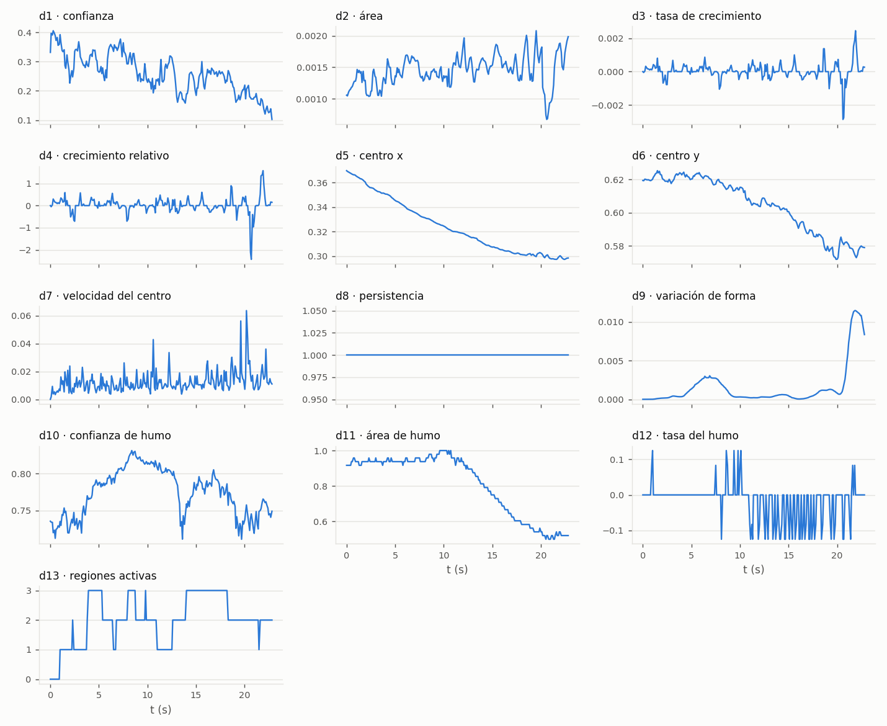
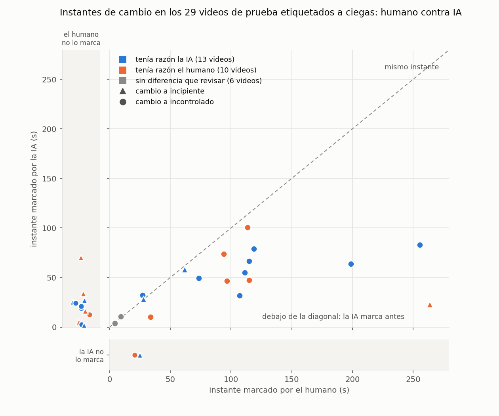
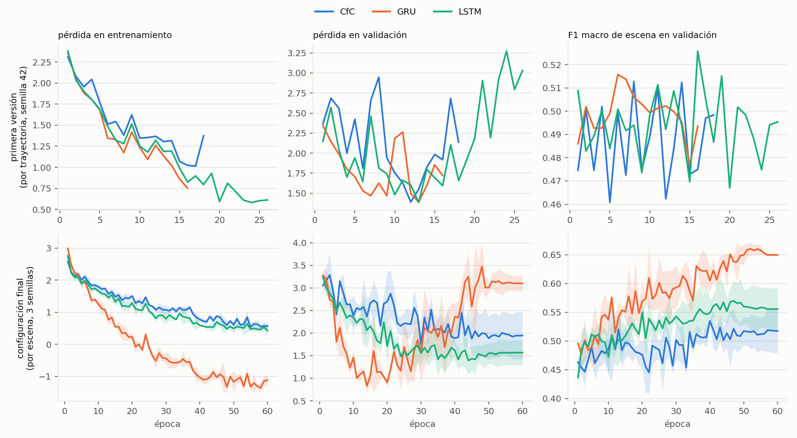
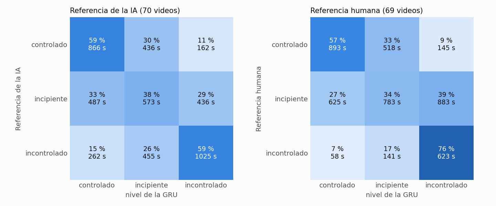
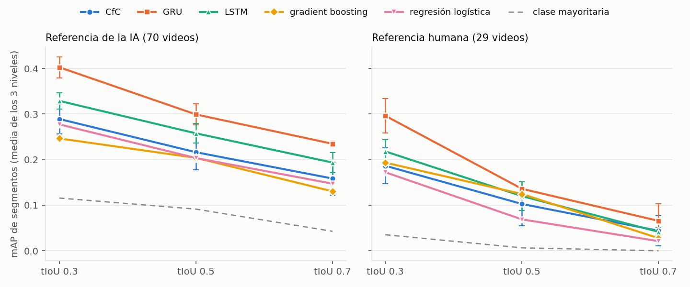
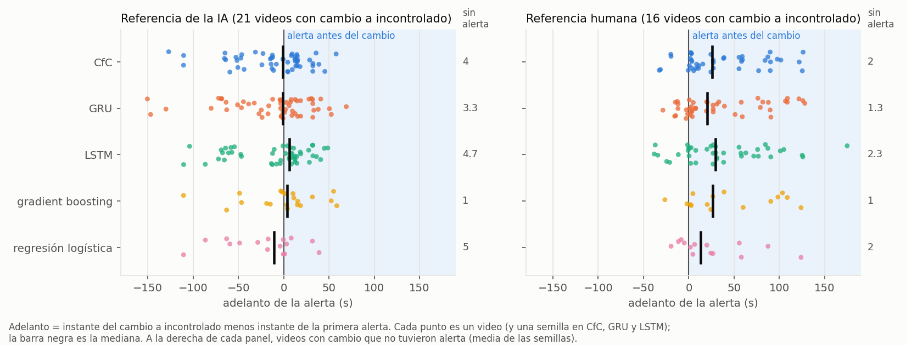
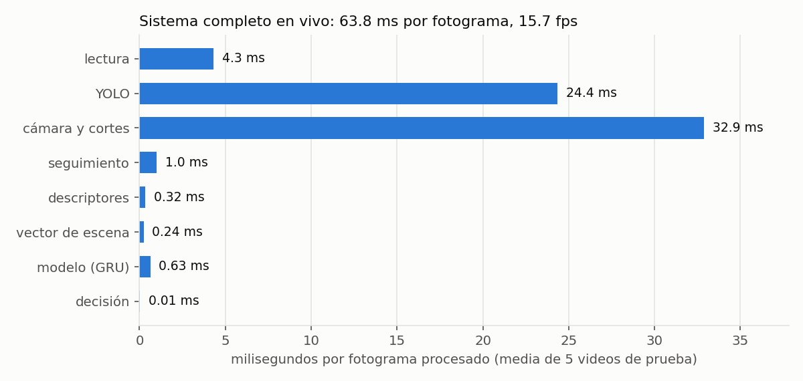
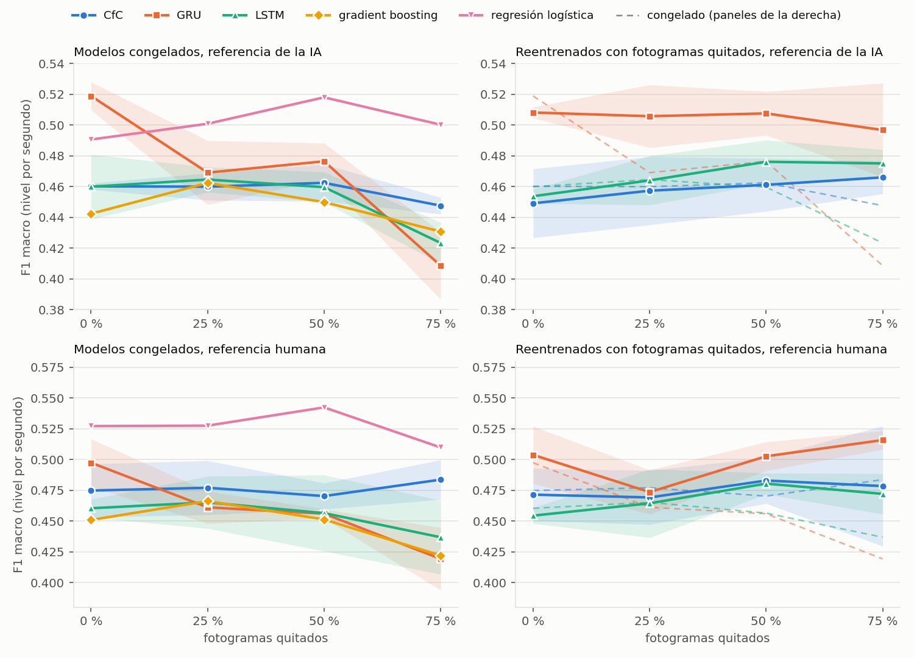
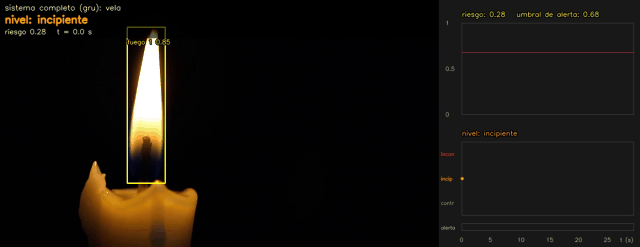

# Detección temprana y clasificación de la severidad de incendios en video mediante localización temporal

Tesis de pregrado en Ciencia de la Computación, Universidad Nacional de San Agustín de Arequipa (Perú). Autor: Alessander Jesús Carazas Quispe. Asesor: Carlos Eduardo Atencio Torres.

**Estado:** avance del 80 %, 13 de noviembre de 2026, rama `avance-80`.

El sistema recibe un video, detecta y sigue las regiones de fuego y humo, y describe cada región con 13 descriptores y la escena con un vector de 34 valores. Un modelo recurrente con el intervalo de tiempo real entre fotogramas (CfC, comparado con GRU y LSTM) estima en cada momento el nivel de severidad (controlado, incipiente o incontrolado), un riesgo continuo y el tiempo al peligro. Una histéresis de 2 s estabiliza el nivel, una alerta calibrada con predicción conformal avisa del peligro, y la salida son segmentos `(inicio, fin, nivel)`.

## Pipeline

*Las ocho etapas del sistema, todas implementadas: del video con marcas de tiempo a la detección y el seguimiento, los descriptores, el modelo temporal por escena, la estimación de riesgo, la calibración con histéresis y la salida con nivel, alerta y tiempo estimado.*

## Qué se hizo en el 80 %

| Fase | Qué se hizo | Resultado principal |
|---|---|---|
| A. Correcciones | Descriptores v2 (tasas sobre el área suavizada, región de humo mínima, regiones activas de al menos 1 s), normalización, cortes de escena y exclusión de duplicados | 26 de 37 cortes revisados detectados y ningún corte falso en los videos de fuego |
| B. Etiquetas | Etiquetado con IA en dos pasadas de 210 videos con crecimiento y validación humana a ciegas; riesgo continuo en escalón (0, 0.5 y 1) | Instantes de cambio: la IA marca antes, con una mediana de 32 s de diferencia |
| C. Datos | Partición por grupo de origen y secuencias por escena | 343 videos de entrenamiento, 75 de validación, 72 de calibración y 102 de prueba |
| D. Modelo | Compuerta de contexto + CfC, GRU y LSTM con tres salidas (nivel ordinal CORAL, riesgo y tiempo al peligro), 3 semillas, configuración congelada antes de la prueba | En validación: GRU 0.641, CfC 0.536 y LSTM 0.548 de F1 macro |
| E. Decisión | Histéresis de 2 s, alerta conformal por video (alfa 0.10) y segmentos | Ninguna falsa alarma de los modelos temporales en los 28 videos sin fuego de validación |
| F. Evaluación | Prueba evaluada una sola vez contra las dos referencias, velocidad del sistema en vivo y demo | GRU: F1 macro 0.519 (IA) y 0.497 (humana); 15.7 fps |
| Robustez | Fotogramas quitados al azar (25, 50 y 75 %), reentrenamiento con fotogramas quitados y cámara móvil contra fija | Sin reentrenar, con el 75 % quitado la CfC pierde menos del 3 % de F1 (no significativo) y la GRU el 21 % |

Las etiquetas de entrenamiento las generó la IA (Claude Sonnet 5.5) y se validaron con etiquetado humano a ciegas: 40 videos al azar con un nivel por video (acuerdo del 85 %, kappa 0.80) y 29 videos con crecimiento reproducidos para marcar cada cambio (acuerdo por segundo del 59 %, kappa 0.43).

## Evidencias por fase

### Fase A: cortes de escena y descriptores v2

*Distancia entre los histogramas de fotogramas consecutivos en 83 pares revisados a mano. Los triángulos son cortes reales y la zona sombreada es donde la regla marca corte: con la cámara bien estimada exige 0.85 y sin ella 0.65. Detecta 26 de los 37 cortes y no marca ningún par sin corte.*

*Los 13 descriptores de una trayectoria de fuego durante 23 s. La región se desplaza de forma continua (d5 y d6), sigue detectada todo el tiempo (d8) y el humo a su alrededor baja del 95 % al 50 % de la región ampliada desde los 10 s (d11).*

### Fase B: etiquetado con IA y validación humana

*Tanda de ensayo del etiquetado: cinco subagentes, uno por lote de 10 videos. Sus respuestas se descartaron porque cuatro ejecutaron comandos que el prompt prohibía; desde entonces cada subagente solo puede leer su lote y escribir sus respuestas.*

*Instante de cada cambio de nivel según el humano y según la IA en los 29 videos de prueba que el humano etiquetó a ciegas. La mayoría de los puntos queda bajo la diagonal: la IA marca el cambio antes. En la revisión posterior de las 23 diferencias, la IA tenía razón en 13 y el humano en 10, así que ninguna referencia es superior y en la prueba pesan igual.*

### Fase D: entrenamiento

*Arriba, la primera versión, con un modelo por trayectoria: el F1 de escena oscila entre 0.46 y 0.53 sin mejorar. Abajo, la configuración final, con un modelo por escena (media de 3 semillas): el F1 de validación sube hasta 0.65 en la GRU y se queda entre 0.52 y 0.56 en la CfC y la LSTM. La pérdida total puede ser negativa porque incluye los términos de la ponderación por incertidumbre, y la de validación de la GRU sube desde la época 20 aunque su F1 sigue mejorando; por eso la época se elige por el F1.*

### Fase F: evaluación en la prueba

*Nivel de la GRU contra cada referencia, en segundos. El incipiente es el nivel más confundido: contra la referencia de la IA, un tercio de sus segundos sale como controlado. Contra la referencia humana, el 39 % del incipiente sale como incontrolado y el incontrolado se reconoce mejor (76 %), lo que concuerda con que el modelo aprendió de las etiquetas de la IA, que pasan antes a incontrolado.*

*Calidad de los segmentos de nivel según el solapamiento temporal exigido. La GRU queda primera con las dos referencias; contra la referencia humana todos los modelos bajan de 0.14 con tIoU 0.5.*

*Adelanto de la primera alerta respecto al cambio a incontrolado, por video. Contra la referencia de la IA, la mediana de los modelos temporales está entre -3 y +4 s; contra la humana, su alerta llega entre 20 y 30 s antes, porque el humano marca el cambio más tarde.*

*Tiempo medio por etapa del sistema completo, fotograma a fotograma, en 5 videos de prueba. El movimiento de cámara y YOLO ocupan el 90 % del tiempo; el modelo temporal tarda menos de 1 ms.*

### Robustez: fotogramas quitados

*F1 macro del nivel al quitar al azar el 25, 50 y 75 % de los fotogramas de la prueba. Sin reentrenar (izquierda), la CfC se mantiene y la GRU cae de 0.52 a 0.41; reentrenados con fotogramas quitados (derecha), los tres modelos se mantienen estables.*

### Demo

*El sistema completo con la GRU sobre una vela. Durante los primeros 2 s marca incipiente mientras acumula historia; después pasa a controlado, el riesgo baja a 0.03 y la alerta no se activa. Video de Pexels (ID 19151618).*

## Resultados principales en la prueba

La prueba tiene 70 videos de fuego con referencia de la IA, 69 con referencia humana (29 de ellos con cambios marcados) y 32 sin fuego, y se evaluó una sola vez con la configuración congelada. El nivel final usa umbral 0.5 e histéresis de 2 s; la alerta usa alfa 0.10. CfC, GRU y LSTM son la media de 3 semillas. Los intervalos son del 95 %, por bootstrap de 1000 remuestreos de videos.

| Modelo | Referencia | F1 macro [IC 95 %] | Kappa lineal [IC 95 %] | mAP tIoU 0.5 | Falsas alarmas sin fuego | Falsas alarmas en controlados | Adelanto mediano (alerta antes del cambio) |
|---|---|---|---|---|---|---|---|
| CfC | IA | 0.460 [0.393, 0.522] | 0.319 [0.183, 0.442] | 0.216 [0.151, 0.303] | 0 de 32 | 7 de 30 (23 %) | +0.7 s (8.3 de 21) |
| CfC | humana | 0.475 [0.410, 0.540] | 0.345 [0.241, 0.449] | 0.103 [0.066, 0.199] | 0 de 32 | 5.3 de 29 (18 %) | +23.6 s (12.3 de 16) |
| GRU | IA | 0.519 [0.433, 0.603] | 0.371 [0.225, 0.516] | 0.299 [0.219, 0.400] | 0 de 32 | 6.7 de 30 (22 %) | -2.7 s (8.3 de 21) |
| GRU | humana | 0.497 [0.416, 0.579] | 0.352 [0.238, 0.472] | 0.136 [0.071, 0.290] | 0 de 32 | 6 de 29 (21 %) | +20.5 s (11.3 de 16) |
| LSTM | IA | 0.460 [0.396, 0.526] | 0.323 [0.204, 0.438] | 0.258 | 0 de 32 | 7 de 30 (23 %) | +4.4 s (9 de 21) |
| LSTM | humana | 0.460 [0.391, 0.528] | 0.340 [0.244, 0.440] | 0.120 | 0 de 32 | 6.7 de 29 (23 %) | +29.7 s (10.7 de 16) |
| gradient boosting | IA | 0.442 [0.368, 0.525] | 0.292 [0.178, 0.413] | 0.204 [0.140, 0.305] | 1 de 32 | 8 de 30 (27 %) | +3.8 s (12 de 21) |
| gradient boosting | humana | 0.451 [0.362, 0.531] | 0.320 [0.218, 0.426] | 0.125 [0.066, 0.257] | 1 de 32 | 6 de 29 (21 %) | +26.6 s (13 de 16) |
| regresión logística | IA | 0.491 [0.407, 0.570] | 0.311 [0.158, 0.449] | 0.204 | 0 de 32 | 3 de 30 (10 %) | -10.5 s (5 de 21) |
| regresión logística | humana | 0.527 [0.433, 0.604] | 0.365 [0.220, 0.485] | 0.069 | 0 de 32 | 2 de 29 (7 %) | +13.2 s (10 de 16) |

Contra la referencia de la IA, la GRU tiene el mejor F1 macro, kappa y mAP, pero las diferencias pareadas no son significativas: GRU menos CfC da +0.059 de F1 (IC de -0.006 a +0.128) y GRU menos gradient boosting +0.077 (de -0.008 a +0.151). La única diferencia significativa es el mAP con tIoU 0.5 de la GRU frente a la CfC contra la IA (+0.083, de +0.002 a +0.162). Contra la referencia humana, la regresión logística queda primera en F1 macro, pero tiene el mAP más bajo. El gradient boosting y la regresión logística son referencias sin modelo temporal, entrenadas sobre la media por segundo del vector de escena.

| Modelo | Referencia | Congelado, 0 % quitado | Congelado, 75 % quitado | Reentrenado, 0 % quitado | Reentrenado, 75 % quitado |
|---|---|---|---|---|---|
| CfC | IA | 0.460 | 0.448 | 0.449 | 0.466 |
| CfC | humana | 0.475 | 0.484 | 0.472 | 0.478 |
| GRU | IA | 0.519 | 0.409 | 0.508 | 0.497 |
| GRU | humana | 0.497 | 0.419 | 0.504 | 0.516 |
| LSTM | IA | 0.460 | 0.423 | 0.454 | 0.475 |
| LSTM | humana | 0.460 | 0.437 | 0.454 | 0.472 |

Sin reentrenar, la CfC cae significativamente menos que la GRU al quitar el 75 % de los fotogramas: la diferencia de caídas relativas del F1 es de +18.5 puntos (IC de +1.7 a +32.3) contra la IA y de +17.6 (de +0.6 a +33.6) contra la humana. Al reentrenar con fotogramas quitados, la diferencia deja de ser significativa (+6.0, de -7.6 a +19.2, contra la IA).

## Cómo ejecutarlo

Probado en Windows 11 con Python 3.10, PyTorch 2.5.1 (CUDA 12.1) y una GPU RTX 3050 Ti de 4 GB: `pip install -r requirements.txt`. Los videos de DetectiumFire, FASDD y los pesos no están en el repositorio; los videos se esperan en `real_video/real_video/fire` y `non_fire`, y el detector en `runs_fuego/fasdd_v8s_full/weights/best.pt`.

| Paso | Comando |
|---|---|
| Pipeline (lectura, YOLO, seguimiento, cámara, cortes, descriptores y datos por fotograma) | `python descriptores_v3.py --lista <videos.csv> --salida runs_fuego/descriptores_v3` |
| Validación humana a ciegas | `python etiquetar_v3.py --anotador <nombre> --lista resultados/prueba_cambios.csv --ciego` |
| Partición y vector de escena | `python particion.py` y `python escena_v2.py` |
| Entrenamiento (configuraciones A y B, 3 semillas) | `python reentrenar_escena.py`, `python configuracion_final.py --etapa tasas` y `python configuracion_final.py --etapa final` |
| Fase E en validación y congelado | `python fase_e.py`, `python fase_e_final.py --guardar_referencias runs_fuego/modelos_final/referencias`, `python congelar_configuracion.py --etapa elegir`, `python fase_e_elegida.py --guardar_referencias runs_fuego/modelos_final/referencias` y `python congelar_configuracion.py --etapa congelar` |
| Evaluación en la prueba | `python evaluar_prueba.py` y `python analisis_prueba.py` |
| Sistema en vivo | `python sistema.py --modo fps` y `python sistema.py --modo demo --corridas gru_s42 --archivos 19151618 --nombres vela` |
| Robustez | `python descriptores_v3.py --lista resultados/robustez/lista_prueba.csv --quitar 0.75 --semilla 42 --salida runs_fuego/robustez/quitar_75`, `python evaluar_robustez.py`, `python robustez_parte2.py` y `python analisis_robustez.py` |
| Figuras de este README | `python figuras_readme_80.py` |

## Scripts del 80 %

| Fase | Scripts |
|---|---|
| A | `descriptores_v2.py`, `normalizacion.py`, `cortes.py`, `duplicados.py`, `comparar_descriptores.py`, `figura_cortes.py` |
| B | `etiquetar_ia_v2.py`, `etiquetar_v3.py`, `validar_cambios.py`, `revisar_cambios.py` |
| C | `casi_duplicados.py`, `hojas_casi_duplicados.py`, `particion.py`, `secuencias.py`, `escena.py`, `escena_v2.py`, `descriptores_v3.py`, `vector_escena.py`, `probar_vector_escena.py`, `diagnostico_escena.py` |
| D | `modelo_temporal.py`, `entrenar_temporal.py`, `figura_modelos.py`, `modelo_escena.py`, `entrenar_escena.py`, `comparar_escena.py`, `reentrenar_escena.py`, `entrenar_variantes.py`, `entrenar_final.py`, `configuracion_final.py`, `entrenar_unidad_dt.py`, `congelar_configuracion.py` |
| E | `fase_e.py`, `fase_e_final.py`, `fase_e_elegida.py` |
| F | `evaluar_prueba.py`, `analisis_prueba.py`, `sistema.py`, `figuras_readme_80.py` |
| Robustez | `evaluar_robustez.py`, `entrenar_robusto.py`, `robustez_parte2.py`, `analisis_robustez.py` |

El registro completo de cada paso, con comandos, números y decisiones, está en `resultados/REPORTE.md`.

## Limitaciones

- Las etiquetas de entrenamiento son de la IA y un solo anotador humano valida la prueba; en los instantes de cambio difieren una mediana de 32 s y ninguna de las dos referencias es superior.
- La prueba es pequeña (70 videos de fuego; 21 y 16 con cambio a incontrolado) y, en F1 y kappa, los intervalos de las diferencias entre modelos incluyen el cero.
- Todos los modelos bajan de validación a prueba (la GRU de 0.641 a 0.519), en parte porque la prueba tiene el triple de segundos en incipiente.
- Según la referencia de la IA, la alerta llega casi al mismo tiempo que el cambio (mediana de -3 a +4 s), y las falsas alarmas en controlados (18 a 27 %, salvo la regresión logística) superan el 10 % nominal, aunque con unos 30 videos el intervalo es amplio.
- El paso de controlado a incipiente no se detecta (4 casos en la prueba y ninguno en entrenamiento), y el tiempo al peligro solo supera a una constante contra la referencia de la IA.
- Con cámara móvil todos los modelos empeoran (la GRU de 0.556 a 0.476 contra la IA) y las falsas alarmas en controlados se duplican.
- La robustez usa una sola semilla de quitado; FIgLib, Mamba y las ablaciones quedan para la versión final.

## Créditos y licencias

- **DetectiumFire** ([arXiv:2511.02495](https://arxiv.org/abs/2511.02495)): videos con y sin fuego, e imágenes sin fuego para el detector. Sus videos de búsqueda web se publican bajo [CC BY-NC-SA 4.0](https://creativecommons.org/licenses/by-nc-sa/4.0/) y se usan con fines académicos y no comerciales. No se redistribuyen.
- **FASDD**, subconjunto CV ("FASDD: An Open-access 100,000-level Flame and Smoke Detection Dataset for Deep Learning in Fire Detection", Science Data Bank, DOI [10.57760/sciencedb.j00104.00103](https://doi.org/10.57760/sciencedb.j00104.00103); artículo de Wang et al., 2024, DOI [10.1080/10095020.2024.2347922](https://doi.org/10.1080/10095020.2024.2347922)): entrenamiento y evaluación del detector, bajo [CC BY-SA 4.0](https://creativecommons.org/licenses/by-sa/4.0/) según su registro en Science Data Bank. No se redistribuye.
- **Pexels**: la vela de la demo es el video [19151618](https://www.pexels.com/video/19151618/), bajo la [licencia de Pexels](https://www.pexels.com/license/).
- Las gráficas y el diagrama son de elaboración propia y se comparten bajo [CC BY-NC-SA 4.0](https://creativecommons.org/licenses/by-nc-sa/4.0/). El GIF de la demo contiene el video de Pexels citado arriba, sujeto a su licencia.