# Detección temprana y clasificación de la severidad de incendios en video mediante localización temporal

Tesis de pregrado en Ciencia de la Computación, Universidad Nacional de San Agustín de Arequipa (Perú).

- Autor: Alessander Jesús Carazas Quispe
- Asesor: Carlos Eduardo Atencio Torres

El sistema recibe un video y realiza estos pasos:
1. Detecta y sigue las regiones de fuego y humo.
2. Describe cada región con 13 descriptores.
3. Estima en cada momento la severidad del fuego con una red recurrente de tiempo continuo (CfC).

La salida se convierte en segmentos `(inicio, fin, nivel)`, es decir, en una localización temporal de los niveles de severidad, y en alertas calibradas.

**Estado:** avance del 80 % **en desarrollo** (última actualización: 6 de noviembre de 2026). Las etapas 1 a 4 están implementadas desde el avance del 50 %. En el 80 % se corrigen los datos y se implementan las etapas 5 a 8 (modelo temporal, estimación de riesgo, calibración y salida). La fase A, de correcciones, está terminada, y la fase B, de etiquetas con cambios de nivel, está en curso. La tabla de abajo muestra qué está hecho.

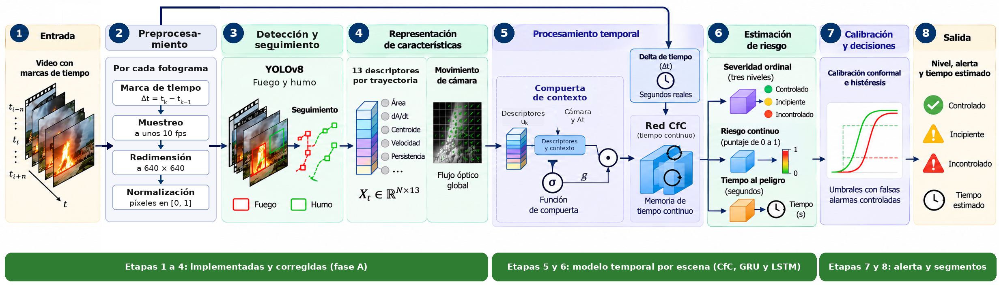

*Figura 4.1 de la tesis, marcada con el estado actual. Cómo leerla: cada caja numerada es una etapa del sistema, de izquierda a derecha, desde el video de entrada hasta el nivel y la alerta; la barra de abajo indica el estado de las etapas que tiene encima. En verde, las etapas implementadas (1 a 4), corregidas en la fase A del 80 %. En ámbar, lo que está en curso: las etiquetas con cambios de nivel con las que se entrenarán las etapas 5 y 6 (fase B); esas cajas se ven apagadas porque aún no están implementadas. En gris, las etapas que aún no empiezan (7 y 8).*

## Avance del 80 %

| Fase | Paso | Estado |
|---|---|---|
| A. Correcciones del 50 % | 1 a 4. Descriptores v2 (tasas con mediana de 1 s, región de humo mínima, d13 con 1 s) y normalización | hecho |
| | 5. Cortes de escena en videos editados: método, umbrales y corrida sobre 604 videos | hecho |
| | 6. Exclusión de archivos duplicados | hecho |
| B. Etiquetas con cambios de nivel | 7. Etiquetado con IA en dos pasadas de los 210 candidatos de crecimiento | en curso: pasada 1 con 198 de 210 videos |
| | 8. Validación humana a ciegas de los cambios de nivel (30 videos) | pendiente |
| | 9. Meta del riesgo continuo | pendiente |
| C. Secuencias | 10 y 11. Partición por origen y secuencias por trayectoria | pendiente |
| D. Modelo | 12 a 14. Compuerta + CfC con 3 salidas, GRU y LSTM de comparación, entrenamiento | pendiente |
| E. Decisión | 15 y 16. Calibración conformal, histéresis y segmentos `(inicio, fin, nivel)` | pendiente |
| F. Evaluación | 17 y 18. Métricas y demo con nivel y alerta | pendiente |
| G. Entrega | 19 y 20. README final y tag `v0.8` | pendiente |

### Pasos 1 a 4: descriptores v2 (`descriptores_v2.py`, `normalizacion.py`)

Se aplica, en orden:

1. **Tasas suavizadas:** d3, d4 y d12 se calculan sobre la mediana del área en el último segundo (solo el pasado, porque el sistema funciona en línea). Cada área pasada se lleva a la escala actual con la escala acumulada de la cámara. La mediana introduce un retraso de unos 0.45 s.
2. **Región de humo mínima:** la región donde se busca humo mide 2 veces la caja de fuego, pero al menos el 20 % del ancho y del alto del fotograma.
3. **Regiones activas:** d13 cuenta solo las trayectorias de fuego que llevan al menos 1 s.
4. **Normalización:** recorte por los percentiles 1 y 99 y estandarización, con estadísticas calculadas solo en entrenamiento.

**Evidencia 1: no se rompió nada.** Con las tres correcciones desactivadas, v2 reproduce exactamente el CSV de v1 en los 4 videos de prueba (1 955 filas, 0 diferencias). Además, 13 pruebas sintéticas (parpadeo, crecimiento lineal, zoom continuo, humo grande, trayectoria nueva, normalización) dan el resultado esperado.

**Evidencia 2: menos ruido** (4 videos, 1 955 filas).

| Medida | v1 | v2 |
|---|---|---|
| Desviación de d3 | 0.084 | 0.021 |
| Desviación de d4 | 1.82 | 0.67 |
| Desviación de d12 | 1.31 | 0.41 |
| Filas con \|d12\| ≥ 5 | 1.8 % | 0.2 % |
| d11 saturada en la vista aérea (llama pequeña) | 35.7 % | 8.6 % |
| d11 saturada con humo denso real | 33.7 % | 31.2 % |

La saturación de d11 baja donde era un artefacto (llama pequeña) y se mantiene donde el humo denso es real.

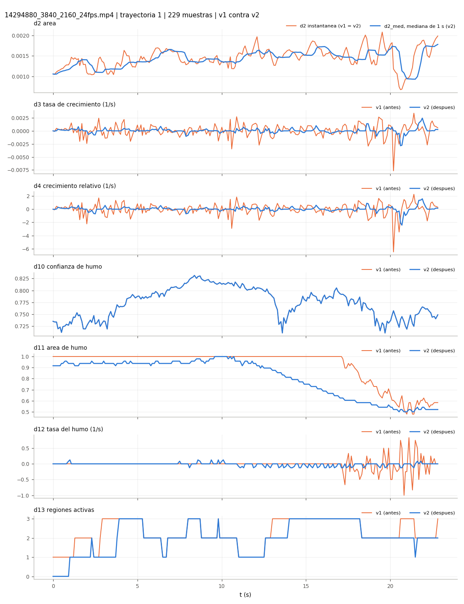

*Cómo leerla: cada panel es un descriptor de la misma trayectoria de fuego (vista aérea, 23 s, 229 muestras); en naranja la versión del 50 % (v1) y en azul la del 80 % (v2). Arriba, el área de cada muestra y su mediana de 1 s: la mediana sigue la tendencia sin los saltos del parpadeo. En d3 y d4 la versión azul queda cerca de 0 mientras el área no cambia, y el pico cerca de los 20 s baja de -6.5 a -2.4. En d11 la versión naranja se queda pegada en 1 hasta los 17 s (saturada), mientras que la azul baja de forma gradual. En d12 desaparecen los saltos del final, y en d13 la azul empieza en 0 porque solo cuenta regiones que llevan al menos 1 s. En d10 las dos versiones coinciden, por eso solo se ve la azul.*

### Paso 5: cortes de escena (`cortes.py`)

Muchos videos son noticias o documentales editados. Un corte de escena rompe el seguimiento, los descriptores y el tiempo al peligro, por lo que se detecta y el video se divide en tramos.

1. **Indicador de color:** distancia de Bhattacharyya entre histogramas HSV de muestras consecutivas (`h`).
2. **Indicador de cámara:** si la estimación del movimiento de la cámara es válida.
3. **Regla:** corte si `h` ≥ 0.85, o si `h` ≥ 0.65 y la cámara no es válida; la cámara sola nunca marca un corte, y entre dos cortes debe haber al menos 1 s.
4. **En cada corte:** se reinician los seguidores, la cámara y los descriptores, y empieza un tramo nuevo.
5. **Tiempo al peligro por tramo:** normal si el paso a Incontrolado ocurre dentro del tramo, 0 si ocurrió en un tramo anterior y enmascarado si ocurre en uno posterior.

**Evidencia 1: umbrales con datos revisados.** Se revisaron a mano 37 cortes y 46 cambios bruscos sin corte (llamaradas, destellos, luces de emergencia, humo); los casos dudosos se resolvieron mirando el video. Los umbrales se eligieron en 13 videos y se comprobaron en otros 11.

| Conjunto | Cortes detectados | Falsos cortes |
|---|---|---|
| Ajuste (13 videos) | 12 de 19 | 0 |
| Validación (11 videos) | 14 de 18 | 0 |

Se eligió no tener falsos cortes: un falso corte cae en explosiones o destellos, justo cuando el fuego pasa a Incontrolado, y reiniciaría el seguimiento en el momento clave. Los cortes perdidos tienen poca diferencia de color (`h` entre 0.27 y 0.64), en su mayoría cambios de encuadre dentro del mismo lugar.

**Evidencia 2: la regla sobre los 83 pares revisados.** Cada punto es un par de muestras consecutivas revisado a mano. Con la cámara válida (arriba) solo se marca corte si `h` ≥ 0.85, porque un destello cambia el color pero el fondo sigue en su lugar; con la cámara no válida (abajo) basta `h` ≥ 0.65. Ningún cambio brusco sin corte cae en la zona sombreada.

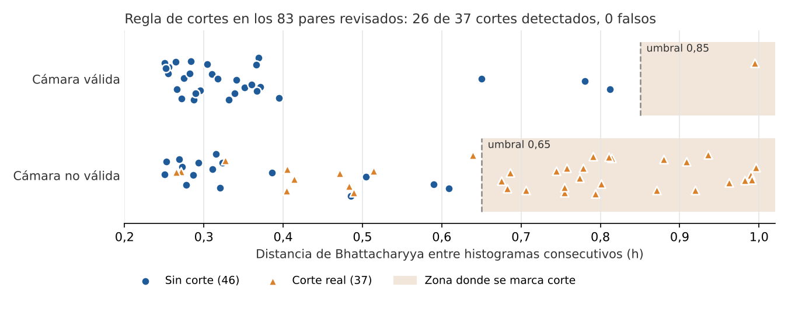

*Cómo leerla: cada punto es un par de muestras consecutivas revisado a mano; los triángulos naranjas son cortes reales y los círculos azules, cambios bruscos sin corte. El eje horizontal mide cuánto cambia el color entre las dos muestras (`h`). La fila de arriba tiene los pares en que la cámara se pudo estimar, y la de abajo, los pares en que no. La zona sombreada es donde la regla marca corte: no cae ningún círculo azul (0 falsos cortes) y caen 26 de los 37 triángulos; los otros 11 son cortes con poco cambio de color.*

**Evidencia 3: corrida completa** sobre 604 videos (389 con fuego y 215 sin fuego, 9.2 h de video, 6.1 h de proceso). Los números de los videos con fuego no cuentan la copia excluida en el paso 6.

| Medida | Valor |
|---|---|
| Videos con fuego con al menos un corte | 60 de 388 (15.4 %) |
| Cortes en videos con fuego | 234 |
| Tramos en videos con fuego | 622 |
| Video más editado | 26 cortes en 155 s |
| Cortes en videos sin fuego | 7: 1 real y 6 por cambios de luz (luces de concierto, relámpagos y una cámara bajo el agua), según una revisión con IA de las hojas de cortes |
| Videos sin fuego con alguna trayectoria de fuego falsa | 14 de 215 (6.5 %) |
| Videos con fuego sin ninguna trayectoria | 6 |

Los 6 falsos cortes en videos sin fuego muestran que la regla no se mantiene con destellos fuertes de tipos que no estaban en el ajuste. Las trayectorias falsas en videos sin fuego son las que debe controlar la calibración de la etapa 7. Cortes por video: [`resultados/cortes/resumen.csv`](resultados/cortes/resumen.csv) y [`resultados/cortes/cortes.csv`](resultados/cortes/cortes.csv).

### Paso 6: archivos duplicados (`duplicados.py`)

1. **Huella:** se calcula el SHA-256 de los 2 468 videos de DetectiumFire.
2. **Grupos:** los archivos con la misma huella son copias exactas, aunque tengan otro nombre.
3. **Exclusión:** de cada grupo se conserva un archivo y se excluyen los demás. La lista la usan los scripts de las fases siguientes.

**Evidencia.** Hay 10 grupos de copias exactas y se excluyen 34 archivos ([`resultados/excluidos.csv`](resultados/excluidos.csv), con el archivo excluido, el que se conserva y su huella). Uno es la copia de un video de la prueba humana guardada con otro nombre (`14296658_3840_2160_24fps - Copy.mp4`); sin esta exclusión, el mismo video habría quedado en entrenamiento y en prueba.

### Paso 7: etiquetado con IA en dos pasadas (`etiquetar_ia_v2.py`, en curso)

Las etiquetas del avance del 50 % usaban 24 fotos por video y marcaron cambio de nivel en solo 3 de 200 videos. Para entrenar la localización temporal se necesitan más cambios y más precisos, así que se etiquetan los 218 candidatos con crecimiento sostenido; 8 de ellos están en la prueba humana y se excluyen, por lo que quedan 210.

Se aplica, en orden:

1. **Pasada 1, tira uniforme:** 48 fotos repartidas en todo el video, en dos imágenes de 24 (6 columnas por 4 filas), cada foto con su número y su instante real. La IA responde el nivel inicial, la foto de cada cambio y el tramo útil, con las mismas claves de la fase 1.
2. **Pasada 2, tira densa (pendiente):** solo para los cambios marcados en la pasada 1 y solo si sus fotos están a más de 1 s. Se arma una tira con una foto cada 0.5 s alrededor del cambio para precisar el instante.
3. **Prompt fijo:** [`prompts/prompt_severidad_v2.txt`](prompts/prompt_severidad_v2.txt). Las definiciones de los tres niveles y las 7 reglas son copia textual del prompt de la fase 1 (comprobado con `diff`).
4. **Subagentes:** Claude Sonnet 5.5, un subagente nuevo por lote de 10 videos, en tandas de 5 lotes. Cada uno usa un agente que solo puede leer y escribir archivos, sin ejecutar comandos.
5. **Lo que la IA no ve:** las propuestas de las reglas, las curvas de área, las etiquetas de la fase 1 ni los tiempos reales de las fotos.
6. **Controles de cada respuesta:** JSON válido, modelo reportado igual a `claude-sonnet-5-5` y una prueba de lectura: la IA debe escribir los instantes que lee en las fotos 24 y 48, y deben coincidir con los reales. Si no coinciden, el video se repite.

Las respuestas crudas quedan en `resultados/ia_crudo_v2/`, una por video.

**Evidencia 1: tanda de ensayo.** La primera tanda (50 videos) se corrió con el agente general. Sus 50 respuestas eran válidas, pero 4 de los 5 subagentes ejecutaron comandos que el prompt prohíbe y no se podía comprobar que hubieran visto las dos imágenes de cada video. Por eso se agregaron el agente que solo lee y escribe y la prueba de lectura, y la tanda se repitió con el protocolo final. Las respuestas del ensayo se guardan aparte (`resultados/ia_crudo_v2_ensayo/`) y no se usan como etiquetas.

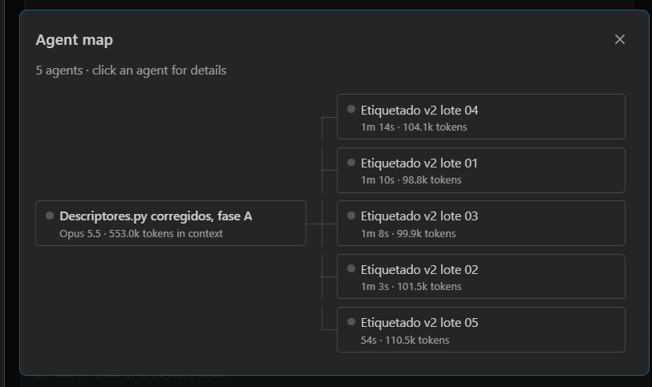

*Captura de la tanda de ensayo. Cómo leerla: a la izquierda, la sesión principal que coordina el etiquetado; a la derecha, los cinco subagentes que trabajaron en paralelo, uno por lote de 10 videos, con el tiempo que tardó cada uno (alrededor de 1 minuto) y los tokens que procesó. Esta tanda se repitió después con el protocolo final.*

En el ensayo, 13 de 49 videos tienen algún cambio de nivel (1 solo a Incipiente, 11 solo a Incontrolado y 1 con ambos), contra 3 de 200 en la fase 1, como se espera en videos elegidos por su crecimiento. Si la IA marca cambios de más, se verá en la validación humana del paso 8.

**Evidencia 2: avance de la pasada 1.**

| Tanda | Lotes | Videos | Estado |
|---|---|---|---|
| 1, repetida con el protocolo final | 1 a 5 | 50 | hecha |
| 2 | 6 a 10 | 50 | hecha |
| 3 | 11 a 15 | 50 | hecha: 50 respuestas válidas, 1 video descartado |
| 4 | 16 a 20 | 50 | 48 hechos; 2 por repetir, porque un subagente se detuvo antes de escribirlos |
| 5 | 21 | 10 | pendiente |

Resultado parcial con 198 videos: todas las respuestas pasan los controles (JSON válido, modelo `claude-sonnet-5-5` e instantes de las fotos 24 y 48 correctos), 4 videos se descartan y 63 de los 194 restantes (32.5 %) tienen algún cambio de nivel. El acuerdo entre el ensayo y la repetición está en [`resultados/REPORTE.md`](resultados/REPORTE.md). Al cerrar la pasada 1 se publicarán los cambios por tipo, los motivos de descarte y la consistencia con las etiquetas de la fase 1 en los 21 videos que tienen ambas.

## Evolución entre avances

El avance del 30 % (rama [`avance-30`](https://github.com/AlessanderLCarazas/tesis-severidad-incendios/tree/avance-30)) tenía solo la detección y los datos preparados, y el del 50 % (rama [`avance-50`](https://github.com/AlessanderLCarazas/tesis-severidad-incendios/tree/avance-50)) implementó las etapas 1 a 4:

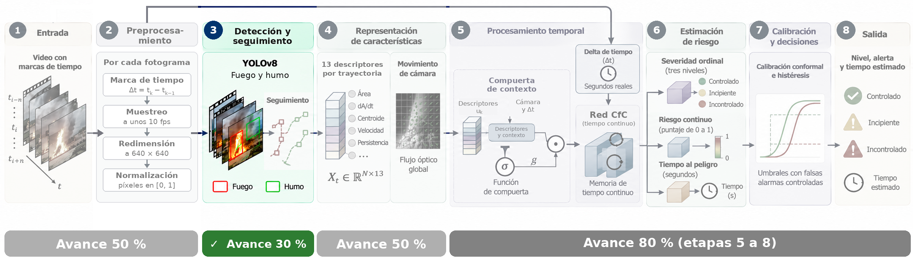

*La figura marcada para el avance del 30 %: en verde, solo la detección de fuego y humo.*

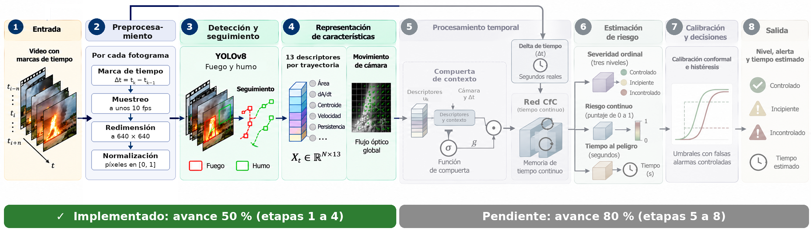

*La figura marcada para el avance del 50 %: en verde, las etapas 1 a 4.*

| Componente | Avance 30 % | Avance 50 % | Avance 80 % (hasta ahora) |
|---|---|---|---|
| Etapas 1 y 2: entrada y preprocesamiento | sin implementar | lector con marca de tiempo real, `dt_k` y muestreo a unos 10 fps | sin cambios |
| Etapa 3: detección | YOLOv8s entrenado y evaluado (mAP50 0.867) | el mismo detector | el mismo detector |
| Etapa 3: seguimiento | sin implementar | ByteTrack por clase, Kalman con `dt` real (tope de 2 periodos) y compensación de la cámara | además, se reinicia en cada corte de escena |
| Etapa 4: movimiento de la cámara | sin implementar | Shi-Tomasi, Lucas-Kanade y similitud con RANSAC | sin cambios; su validez se usa para detectar cortes |
| Etapa 4: descriptores | sin implementar | 13 descriptores por trayectoria y muestra | versión 2: tasas con mediana de 1 s, región de humo mínima, d13 con 1 s y normalización |
| Cortes de escena y duplicados | sin implementar | sin implementar | regla de histograma y cámara (0 falsos cortes en los pares revisados), corrida de 604 videos y 34 duplicados excluidos |
| Etiquetado de la severidad | curvas de área con reglas y herramienta manual | etiquetas con IA en 200 videos y validación humana a ciegas en 40 (acuerdo 85 %, kappa 0.80) | en curso: etiquetado con IA en dos pasadas de 210 candidatos (198 hechos en la pasada 1), con prueba de lectura |
| Evidencias | métricas del detector | demos en video, pruebas del filtro de Kalman y de la cámara, figuras del etiquetado | comparación de descriptores v1 y v2, figura de la regla de cortes, corrida completa y captura del ensayo del etiquetado |

Los cambios exactos de código se ven en las comparaciones de ramas [`avance-30...avance-50`](https://github.com/AlessanderLCarazas/tesis-severidad-incendios/compare/avance-30...avance-50) y [`avance-50...avance-80`](https://github.com/AlessanderLCarazas/tesis-severidad-incendios/compare/avance-50...avance-80).

## Demo: etapas 1 a 4 sobre video

Resultado de las etapas 1 a 4 sobre dos videos completos (el detector se entrenó solo con imágenes). Las cajas muestran cada trayectoria de fuego y humo con su ID. El panel muestra el área (d2), la tasa de crecimiento (d3) y el área de humo (d11) de la región principal (la trayectoria de fuego de mayor área en cada instante).

**Fuego controlado (vela):** el área se mantiene estable y no hay humo.

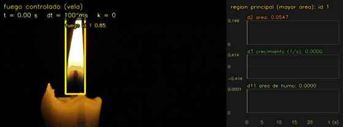

*Video de [Pexels](https://www.pexels.com/video/19151618/) (ID 19151618).*

**Fuego que se propaga (basural):** el fuego avanza a lo largo de la basura y aparece humo. La cámara va en mano, así que parte de la variación del área se debe al movimiento de la cámara.

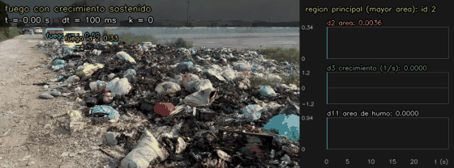

*Video del dataset DetectiumFire (arXiv:2511.02495), CC BY-NC-SA 4.0.*

## Etapas implementadas

Para cada etapa se indica qué se aplica, en el orden en que se ejecuta, y la evidencia de que funciona. Los números salen de [`resultados/REPORTE.md`](resultados/REPORTE.md) y de los CSV de `resultados/`.

### Etapa 1: Entrada (`preprocesamiento.py`)

1. **Lectura del video:** se abre con OpenCV (`cv2.VideoCapture`) y se recorre fotograma a fotograma.
2. **Marca de tiempo real:** de cada fotograma se lee su instante `t_k` (`CAP_PROP_POS_MSEC`), sin suponer un fps fijo.
3. **Corrección de marcas:** si una marca no avanza respecto a la anterior, se le suma un periodo del video, para que el tiempo siempre crezca.

La salida es la secuencia `V = {(I_k, t_k)}`: cada fotograma con su instante.

### Etapa 2: Preprocesamiento (`preprocesamiento.py`)

1. **Muestreo a unos 10 fps:** se toma el fotograma más cercano a cada punto de una rejilla de 100 ms; los demás se saltan sin decodificarlos.
2. **Intervalo de tiempo:** `dt_k = t_k - t_{k-1}` entre muestras consecutivas, con las marcas reales.
3. **Redimensión:** a 640x640 con relleno (letterbox), conservando la proporción.
4. **Normalización:** píxeles a [0, 1].

Los pasos 3 y 4 los aplica Ultralytics al pasar la imagen al detector.

**Evidencia.** En un video a 25 fps, 500 fotogramas quedan en 200 muestras, y `dt_k` alterna entre 80 y 120 ms (media 100.1 ms), porque la rejilla de 40 ms del archivo no divide los 100 ms. Por eso el sistema trabaja con el `dt_k` real y no con un periodo fijo.

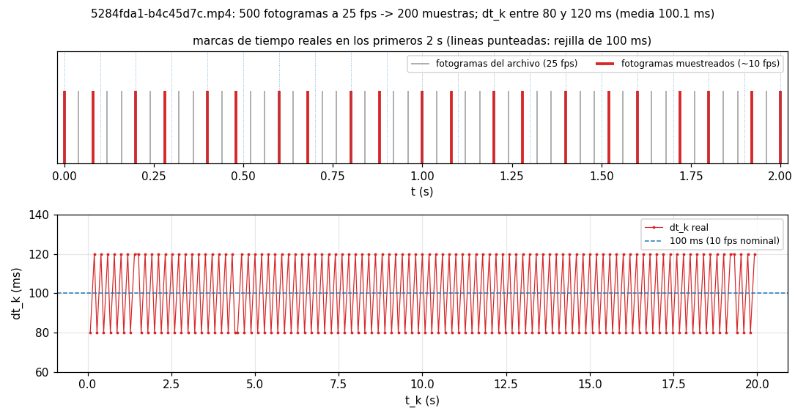

### Etapa 3: Detección y seguimiento (`seguimiento.py`)

En cada muestra se aplica, en orden:

1. **Detección (YOLOv8s):** cajas de fuego y de humo con su confianza (entrada de 640, confianza mínima 0.1).
2. **Un seguidor por clase:** las detecciones de fuego y las de humo van a dos ByteTrack separados.
3. **División por confianza (ByteTrack):** detecciones de alta confianza (0.25 o más) y de baja confianza (entre 0.1 y 0.25).
4. **Predicción del filtro de Kalman:** cada trayectoria predice su caja en la muestra actual. La matriz de transición usa `dt_rel = min(dt_k / 0.1 s, 2)`, y el ruido de proceso se escala con el mismo factor.
5. **Compensación de la cámara:** las cajas predichas se mueven con la similitud estimada en la etapa 4, como en BoT-SORT.
6. **Primera asociación:** trayectorias contra detecciones de alta confianza, por IoU ponderada por la confianza, con el algoritmo húngaro.
7. **Segunda asociación:** las trayectorias que quedaron sin pareja contra las detecciones de baja confianza, por IoU.
8. **Corrección del filtro de Kalman:** cada trayectoria emparejada actualiza su estado con su detección.
9. **Altas y bajas:** una detección de alta confianza sin pareja inicia una trayectoria nueva; una trayectoria sin detección se conserva 30 muestras (unos 3 s) y luego se elimina.

**Evidencia 1: detector.** YOLOv8s preentrenado en COCO, entrenado 30 épocas con el subconjunto CV de FASDD más las imágenes sin fuego de DetectiumFire. Resultados en la partición de prueba:

| mAP50 | mAP50-95 | Precisión | Recall | AP50 fuego | AP50 humo |
|---|---|---|---|---|---|
| 0.867 | 0.616 | 0.87 | 0.766 | 0.881 | 0.853 |

Salida completa de la evaluación: [`resultados/detector_prueba.txt`](resultados/detector_prueba.txt).

**Evidencia 2: seguimiento en video.** Los dos videos de la sección [Demo](#demo-etapas-1-a-4-sobre-video).

**Evidencia 3: variantes del filtro de Kalman** (fuego, suma de 4 videos de prueba). Con todos los fotogramas, `dt_k` casi no varía y las cuatro variantes coinciden. Al quitar el 50 % de los fotogramas, el `dt` real sin tope extrapola la velocidad ruidosa de la llama y corta más trayectorias; con un tope de 2 periodos queda con menos cortes que el original.

| Variante | Todos los fotogramas: trayectorias / cortes | Quitando el 50 %: trayectorias / cortes |
|---|---|---|
| original (`dt` = 1) | 114 / 26 | 62 / 9 |
| `dt` real | 114 / 26 | 68 / 13 |
| `dt` real con tope 2 (sistema) | 114 / 26 | 64 / 7 |
| `dt` solo en el ruido de proceso | 114 / 26 | 60 / 8 |

### Etapa 4: Representación de características (`camara.py`, `descriptores.py`)

**A. Movimiento de la cámara**, entre cada par de muestras:

1. **Preparación:** la imagen pasa a escala de grises y se reduce a 960 px de ancho.
2. **Máscara:** se excluyen las cajas de fuego, porque el fuego se mueve por sí mismo y no sirve para medir la cámara. El humo no se excluye: sus puntos los descarta RANSAC como valores atípicos.
3. **Shi-Tomasi:** elige hasta 400 esquinas en la zona permitida.
4. **Lucas-Kanade piramidal:** sigue esas esquinas hasta la muestra siguiente.
5. **Similitud con RANSAC:** ajusta escala `s`, rotación y traslación `(tx, ty)`, y descarta los puntos que no la cumplen (umbral de 3 px, confianza 0.99).
6. **Validación:** la estimación se acepta si hay al menos 10 puntos y 50 % de inliers; si no, se toma la cámara como quieta.

**B. Descriptores**, por cada trayectoria de fuego y muestra:

1. **De la caja:** confianza (d1), área relativa (d2) y centro (d5-d6).
2. **Con la escala acumulada de la cámara y la mediana del área en el último segundo:** tasa de crecimiento compensada (d3) y crecimiento relativo (d4).
3. **Con la traslación de la cámara:** velocidad del centro compensada (d7).
4. **En una ventana de 3 s:** persistencia (d8) y variación de forma (d9).
5. **Con el humo en una región 2 veces mayor que la caja (al menos el 20 % del ancho y del alto del fotograma):** confianza de humo (d10), área de humo (d11) y su tasa de cambio (d12).
6. **De la escena:** regiones de fuego activas que llevan al menos 1 s (d13).

La salida en cada muestra es la matriz `X_t` de N trayectorias por 13 descriptores. Las definiciones están en la tabla [Los 13 descriptores](#los-13-descriptores). Desde el avance del 80 % se calculan con `descriptores_v2.py`, que además detecta los cortes de escena (paso 5).

**Evidencia 1: compensación de la cámara.** Con los puntos fuera de las cajas de fuego, los cortes bajan de 26 (sin compensar) a 19; con los puntos fuera de todas las cajas, solo a 25.

| Seguimiento (fuego, 4 videos, todos los fotogramas) | Trayectorias | Cortes | Cortas | Cobertura media |
|---|---|---|---|---|
| sin compensar | 114 | 26 | 24 | 0.551 |
| compensando, puntos fuera de todas las cajas | 114 | 25 | 19 | 0.560 |
| compensando, puntos fuera de las cajas de fuego (sistema) | 106 | 19 | 17 | 0.564 |

**Evidencia 2: movimiento estimado.** Traslación, escala e inliers en un video tomado con una cámara en tierra con zoom y paneos, con un alejamiento de zoom hacia los 13 s. En rojo, las muestras descartadas (menos de 10 puntos o menos de 50 % de inliers).


**Evidencia 3: descriptores.** Los 13 descriptores (versión 2) de una trayectoria de fuego en un video aéreo. El centro se desplaza en la imagen por el paneo de la cámara, mientras que la velocidad compensada (d7) queda cerca de 0.

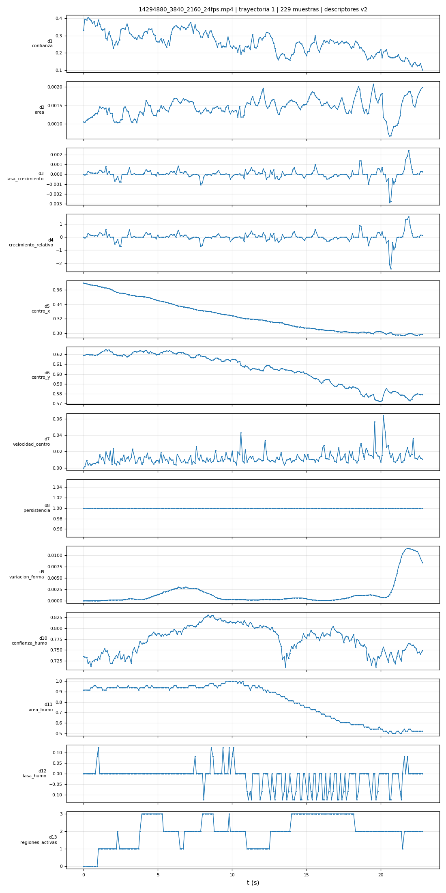

*Cómo leerla: cada panel es uno de los 13 descriptores de la misma trayectoria a lo largo de 23 s, con una muestra cada 0.1 s. El centro de la caja (d5 y d6) baja de forma continua porque la cámara se mueve, pero la velocidad compensada (d7) se queda cerca de 0, porque el fuego en sí no se desplaza. La persistencia (d8) vale 1 porque el fuego se detecta en todas las muestras, y el área de humo (d11) baja de forma gradual desde los 11 s, cuando el humo deja de cubrir la región alrededor del fuego.*

### Etiquetado de la severidad (subproceso que prepara los datos de la CfC)

Para cada video se registran el nivel inicial, los instantes de cambio a Incipiente y a Incontrolado, y el tramo útil. Un cambio cuenta solo si el nuevo nivel se mantiene al menos 2 s. Las etiquetas de entrenamiento las genera una IA, y 40 videos pasan por una validación humana a ciegas.

Se aplica, en orden:

1. **Curva de área (`preanotar.py`):** YOLOv8s recorre el video a 5 fps y mide el área de fuego y de humo en cada fotograma, suavizada con una mediana de 1 s.
2. **Propuesta por reglas (`preanotar.py`):** con la línea base `a0` (fuego) y `h0` (humo) de los primeros 2 s, el video empieza Incontrolado si `a0` es 0.25 o más o `h0` es 0.4 o más; pasa a Incipiente cuando el área supera `max(2·a0, a0 + 0.02)` durante 2 s. Las propuestas inestables se marcan como dudosas, con su motivo.
3. **Tira de 24 fotogramas (`generar_tiras.py`):** fotogramas equiespaciados del video, en una imagen de 6 columnas.
4. **Etiquetado con IA (`etiquetar_ia.py`):** subagentes de Claude (Sonnet) con un prompt fijo (`prompts/prompt_severidad.txt`) ven solo la tira y responden en JSON con el nivel inicial y el número de foto de cada cambio. Se valida cada respuesta y las fotos se convierten a segundos. Las respuestas crudas están en `resultados/ia_crudo/`.
5. **Validación humana a ciegas (`etiquetar_v2.py --ciego`):** 40 videos se etiquetan a mano a partir de la misma tira, sin ver la propuesta de las reglas ni la respuesta de la IA.
6. **Comparación (`comparar_etiquetas.py`):** acuerdo y kappa ponderado entre la validación humana y la IA.

**Evidencia a: curva de área y propuesta por reglas.** Esta propuesta se marcó como dudosa porque el área varía mucho.

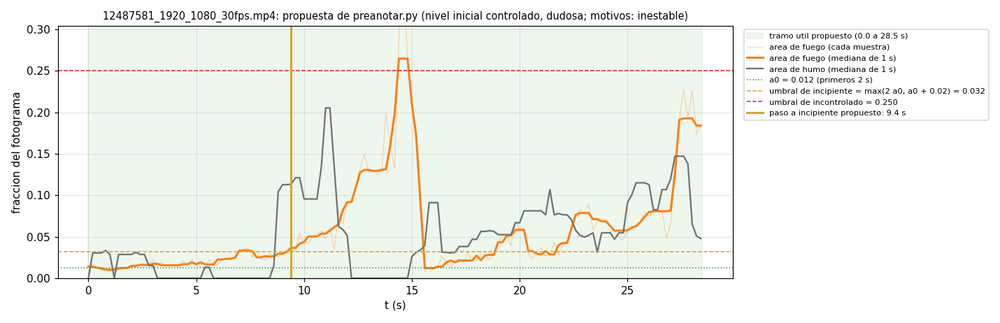

**Evidencia b: tira de 24 fotogramas y respuesta de la IA.** La IA responde con números de foto, que luego se convierten a segundos. Este video está entre los 40 con validación humana: la IA y la validación humana coinciden en Incipiente.

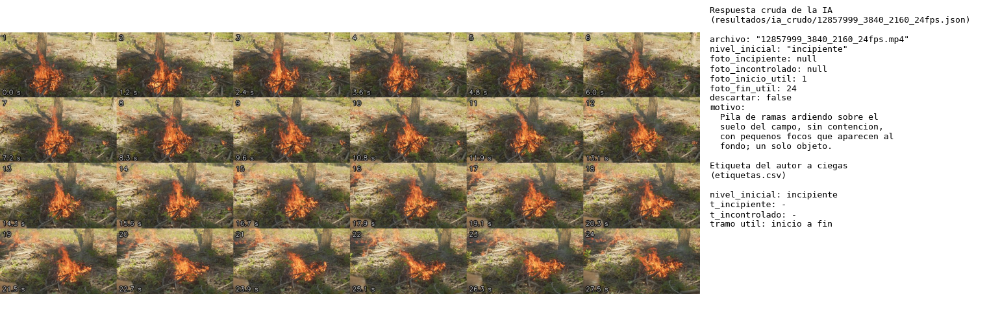

*Video del dataset DetectiumFire (arXiv:2511.02495), CC BY-NC-SA 4.0.*

**Evidencia c: herramienta de etiquetado a ciegas.** Así se ve `etiquetar_v2.py --ciego`: sin propuesta ni curva, renderizada desde el código con la etiqueta guardada en la validación humana (borde amarillo: incipiente; verde: controlado).

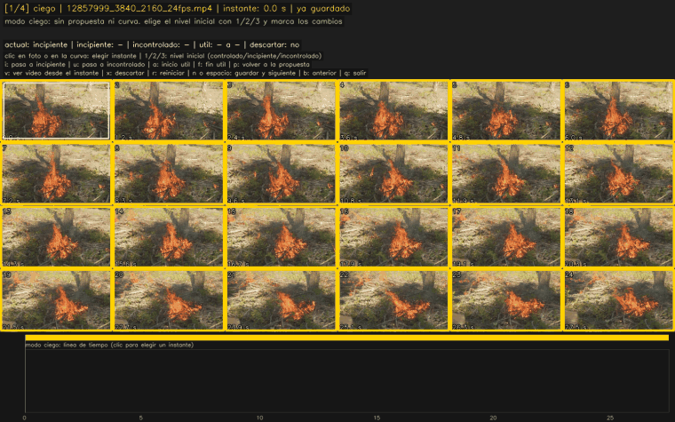

*Videos del dataset DetectiumFire (arXiv:2511.02495), CC BY-NC-SA 4.0, y de [Pexels](https://www.pexels.com/video/19151618/) (vela, ID 19151618).*

**Evidencia d: la IA contra la validación humana.** Nivel inicial de los 40 videos con validación humana a ciegas. El acuerdo es de 85 % (kappa ponderado lineal 0.80).

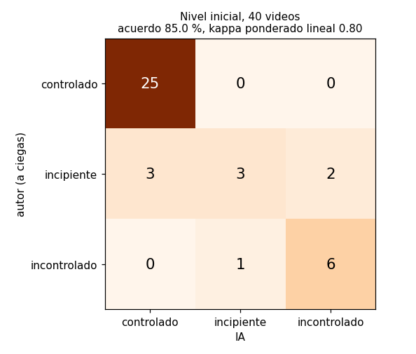

**Evidencia e: conteos.** 200 videos etiquetados por la IA, 40 con validación humana, 1 707 curvas de área y 218 candidatos con crecimiento sostenido para el avance del 80 %.

## Niveles de severidad

Los tres niveles agrupan los de DetectiumFire: sin riesgo → Controlado; riesgo bajo y medio → Incipiente; riesgo alto → Incontrolado.

| Nivel | Definición |
|---|---|
| Controlado | la llama permanece en su fuente (vela, cocina, fogata delimitada) y su tamaño es estable |
| Incipiente | el fuego sale de su fuente o crece de forma sostenida, pero afecta a un solo objeto o a una superficie reducida |
| Incontrolado | el fuego involucra varios objetos o una superficie extensa, o el humo denso ocupa gran parte de la escena |

## Resumen del pipeline

| Etapa | Qué hace | Estado | Script |
|---|---|---|---|
| 1. Entrada | video `V = {(I_k, t_k)}`: cada fotograma llega con su marca de tiempo | implementada | `preprocesamiento.py` |
| 2. Preprocesamiento | marca de tiempo `t_k` y `dt_k = t_k - t_{k-1}`; muestreo a unos 10 fps conservando la marca real; redimensión a 640x640 con relleno y normalización a [0, 1] | implementada | `preprocesamiento.py` |
| 3. Detección y seguimiento | YOLOv8s detecta fuego y humo, y ByteTrack forma las trayectorias con Kalman (`dt_k` real con tope de 2 periodos) y compensación de la cámara | implementada | `seguimiento.py` |
| 4. Representación de características | movimiento de la cámara (Shi-Tomasi, Lucas-Kanade y similitud con RANSAC), cortes de escena y 13 descriptores por trayectoria y fotograma | implementada | `camara.py`, `descriptores_v2.py`, `cortes.py` |
| 5. Procesamiento temporal | compuerta multiplicativa con el contexto de la cámara y `dt_k`, y red CfC con `timespans = dt_k` | avance del 80 % | |
| 6. Estimación de riesgo | severidad (CORAL), riesgo continuo y tiempo al peligro | avance del 80 % | |
| 7. Calibración y decisión | umbral de alerta con predicción conformal por video e histéresis | avance del 80 % | |
| 8. Salida | nivel, alerta, tiempo al peligro, caja de la región y segmentos `(t_s, t_e, nivel)` | avance del 80 % | |

### Los 13 descriptores

| Grupo | N.º | Descriptor | Definición |
|---|---|---|---|
| Detección | 1 | Confianza | confianza de la detección de fuego |
| Tamaño y crecimiento | 2 | Área | `A_k` = área de la caja / área del fotograma |
| | 3 | Tasa de crecimiento | `(Ã_k - S^2 Ã_prev) / dt`, con `Ã` la mediana del área en el último segundo, `Ã_prev` la de la observación anterior de la trayectoria y `S` la escala acumulada de la cámara desde esa observación |
| | 4 | Crecimiento relativo | tasa de crecimiento / `Ã_k` |
| Posición y movimiento | 5-6 | Centro | `(x_k, y_k)` normalizado de la caja |
| | 7 | Velocidad del centro | desplazamiento compensado por la cámara / `dt_k` |
| Comportamiento en el tiempo | 8 | Persistencia | fracción de los últimos 3 s con detección |
| | 9 | Variación de forma | varianza de la relación de aspecto en 3 s |
| Humo | 10 | Confianza de humo | máxima confianza de humo cerca de la caja (región ampliada 2 veces, mínimo 20 % del ancho y del alto del fotograma) |
| | 11 | Área de humo | área de humo en esa región |
| | 12 | Tasa del humo | cambio de la mediana del área de humo en el último segundo / `dt_k` |
| Escena | 13 | Regiones activas | trayectorias de fuego activas que llevan al menos 1 s |

## Instalación

Probado en Windows 11 con Python 3.10, PyTorch 2.5.1 con CUDA 12.1 y una GPU NVIDIA RTX 3050 Ti de 4 GB.

```
pip install -r requirements.txt
```

## Datos y pesos (no incluidos en el repositorio)

| Recurso | Uso | Ubicación esperada |
|---|---|---|
| FASDD, subconjunto CV | entrenar y evaluar el detector | `FASDD/`, convertido a `FASDD_yolo/` con `preparar_fasdd.py` |
| DetectiumFire (imágenes sin fuego y videos) | negativos del detector; videos para el modelo temporal | `real_images/`, `real_video/real_video/fire` y `real_video/real_video/non_fire` |
| Pesos del detector | todas las etapas | `runs_fuego/fasdd_v8s_full/weights/best.pt` (se generan con `entrenar_yolo.py`) |

## Uso

```
python entrenar_yolo.py --modelo yolov8s.pt --epocas 30 --batch 8
python preanotar.py --limite 200
python preprocesamiento.py
python seguimiento.py
python camara.py
python descriptores.py
python demo.py --crecimiento 12487581_1920_1080_30fps.mp4
python figuras_readme.py
python descriptores_v2.py --lista resultados/cortes/lista_noche.csv --salida runs_fuego/descriptores_v2_noche --salida_cortes resultados/cortes --grafico ninguno
```

Cada script usa `argparse` con valores por defecto razonables; ejecuta `python <script>.py --help` para ver sus opciones.

| Script | Qué hace |
|---|---|
| `preparar_fasdd.py`, `revisar_fasdd.py` | arman y verifican el conjunto YOLO de FASDD con los negativos de DetectiumFire |
| `entrenar_yolo.py`, `probar_yolo.py` | entrenan y prueban el detector |
| `seleccionar_videos.py`, `generar_tiras.py` | seleccionan videos y generan las tiras de 24 fotogramas |
| `preanotar.py`, `listar_sin_curva.py` | curva de área por video y propuestas de etiqueta con reglas |
| `etiquetar.py`, `etiquetar_v2.py` | herramientas de etiquetado manual (`--ciego` para la validación a ciegas) |
| `etiquetar_ia.py`, `comparar_etiquetas.py` | lotes y unión de las etiquetas de IA, y comparación humano contra IA |
| `preprocesamiento.py` | lector de video con marcas de tiempo reales, `dt` y muestreo a 10 fps |
| `seguimiento.py` | detección y ByteTrack con `dt` real y compensación de cámara |
| `camara.py` | movimiento de la cámara y su efecto en el seguimiento |
| `descriptores.py` | los 13 descriptores por trayectoria y fotograma |
| `demo.py` | videos y GIF de demostración |
| `figuras_readme.py` | figuras y tablas de las evidencias |
| `descriptores_v2.py` | descriptores v2 y cortes de escena (`--sin_cortes` y los tres parámetros en 0 reproducen v1) |
| `normalizacion.py` | recorte por percentiles y estandarización con estadísticas de entrenamiento |
| `comparar_descriptores.py` | comparación de v1 contra v2 |
| `cortes.py` | detector de cortes de escena, umbrales y tiempo al peligro por tramo |
| `duplicados.py` | huella SHA-256 de los videos y lista de archivos excluidos |
| `etiquetar_ia_v2.py` | etiquetado con IA en dos pasadas: tiras de 48 fotos, lotes, revisión de las respuestas y comparación con el ensayo |
| `figura_cortes.py` | figura de la regla de cortes sobre los pares revisados |

## Créditos y licencia de las imágenes

- **Vela (demo de fuego controlado y última captura de la herramienta):** video de [Pexels](https://www.pexels.com/video/19151618/) (ID 19151618), bajo la [licencia de Pexels](https://www.pexels.com/license/).
- **Las demás imágenes con fotogramas de video:** dataset DetectiumFire ([arXiv:2511.02495](https://arxiv.org/abs/2511.02495)), cuyos videos de búsqueda web se publican bajo [CC BY-NC-SA 4.0](https://creativecommons.org/licenses/by-nc-sa/4.0/). Se usan con fines académicos y no comerciales.
- **Las imágenes y los GIF de este README** se comparten bajo [CC BY-NC-SA 4.0](https://creativecommons.org/licenses/by-nc-sa/4.0/).
- **Criterio de selección:** los fotogramas publicados no tienen marcas de agua, logos de canales o noticieros, texto superpuesto ni caras reconocibles.
- Las gráficas sin fotogramas y las capturas de pantalla son de elaboración propia.

## Ramas

| Rama | Contenido |
|---|---|
| `avance-30` | avance del 30 %: detector entrenado y datos preparados (congelada, tag `v0.3`) |
| `avance-50` | avance del 50 %: etapas 1 a 4, del video a los descriptores (congelada, tag `v0.5`) |
| `avance-80` | avance del 80 %: corrección de datos y etapas 5 a 8 (en desarrollo, esta rama) |
| `main` | desarrollo desde el 80 % hasta la versión final |