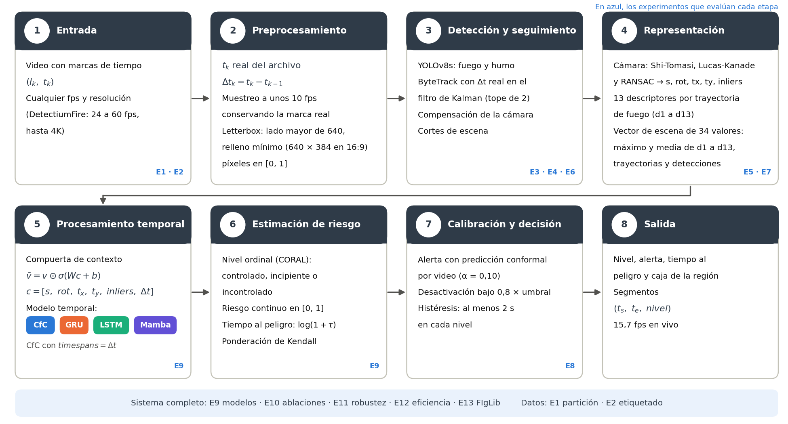
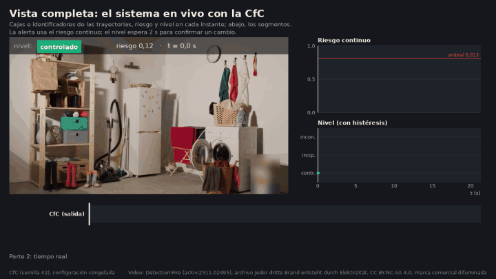
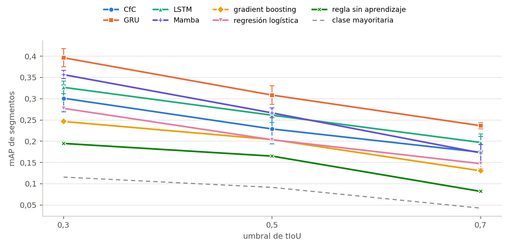
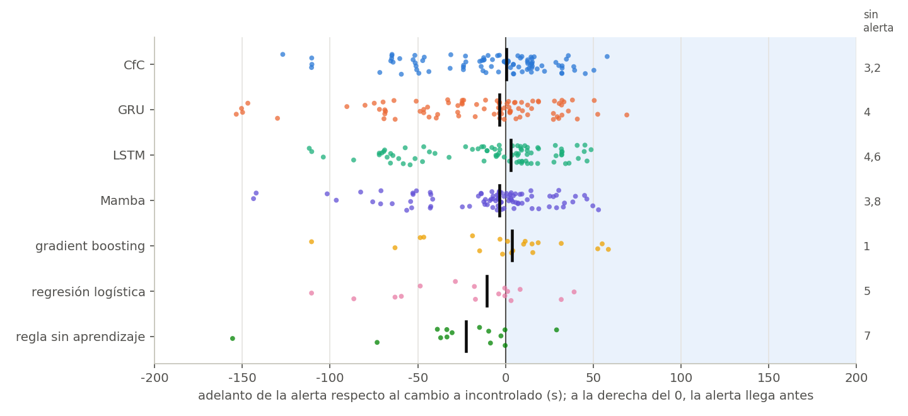
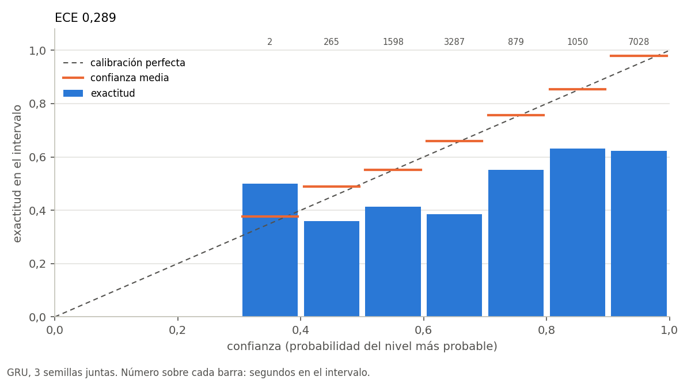
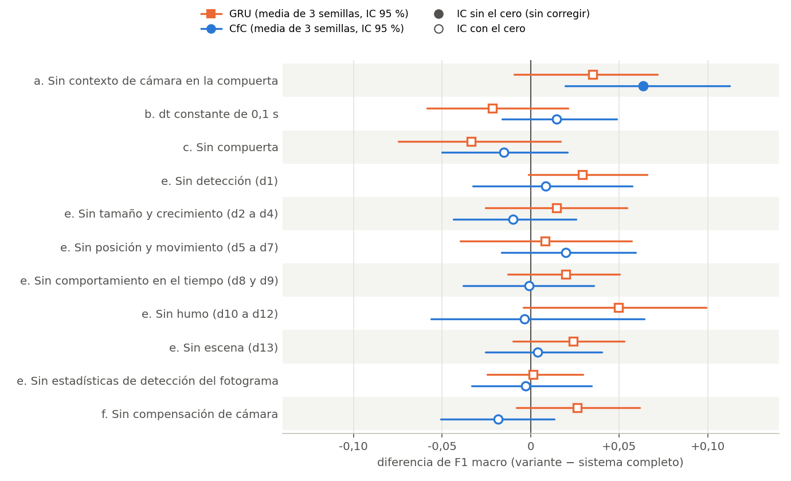
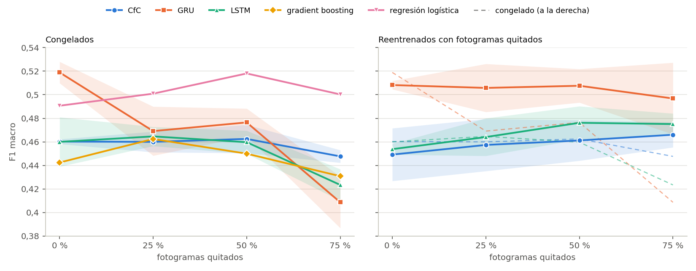

# Detección temprana y clasificación de la severidad de incendios en video mediante localización temporal

Tesis de pregrado en Ciencia de la Computación, Universidad Nacional de San Agustín de Arequipa (Perú). Autor: Alessander Jesús Carazas Quispe. Asesor: Carlos Eduardo Atencio Torres.

**Estado:** versión final (100 %), 20 de noviembre de 2026, rama `main`.

El sistema recibe un video, detecta y sigue las regiones de fuego y humo, y resume la escena en un vector de 34 valores. Un modelo temporal que usa el intervalo real entre fotogramas (CfC, comparada con GRU, LSTM y Mamba) estima en cada momento el nivel de severidad (controlado, incipiente o incontrolado), un riesgo continuo y el tiempo al peligro. Una histéresis de 2 s estabiliza el nivel, una alerta calibrada con predicción conformal avisa del peligro, y la salida son segmentos `(inicio, fin, nivel)`. El sistema se evalúa con 13 experimentos: ocho comparan alternativas dentro de cada etapa y cinco miden el sistema completo.

## Pipeline

*Las ocho etapas del sistema, todas implementadas: del video con marcas de tiempo a la detección y el seguimiento, el vector de escena, el modelo temporal, la estimación de riesgo, la calibración con histéresis y la salida con nivel, alerta y tiempo estimado.*

## Demo: un video por las 8 etapas

*Ejemplo elegido para mostrar un cambio de nivel en la salida de la CfC; no representa el desempeño promedio (ver Resultados). Un video de prueba (no se usó para entrenar ni para fijar el umbral), en el que una vela enciende la cortina de una cocina y que tiene dos cortes de escena, recorre las 8 etapas con la CfC congelada (semilla 42) y la misma cadena del sistema en vivo; arriba, la vista completa. La CfC pasa de controlado a incipiente a los 18.7 s y vuelve a controlado a los 26.3 s; no hay alerta, porque el riesgo máximo (0.633) no supera el umbral (0.813).*

Paso a paso, con la explicación de cada etapa: [docs/demo/PASOS.md](docs/demo/PASOS.md).

Video completo, con las 8 etapas paso a paso y la vista completa (64 s, H.264): [docs/demo/demo_cfc.mp4](docs/demo/demo_cfc.mp4). Video original: `Har du en fungerande brandvarnare_.mp4`, de DetectiumFire ([CC BY-NC-SA 4.0](https://creativecommons.org/licenses/by-nc-sa/4.0/)), con la pantalla de un teléfono y dos rostros difuminados.

## Experimentos

Cada experimento se decide en validación. La prueba se evaluó una sola vez, con la configuración congelada, contra las etiquetas de severidad del sistema. Las diferencias llevan su IC del 95 % por bootstrap pareado de videos y la corrección de Holm.

| Experimento | Qué se comparó | Resultado principal |
|---|---|---|
| E1. Partición y fugas | Agrupación por origen y revisión de 27 pares casi duplicados | Ninguna fuga; 343, 75, 72 y 102 videos |
| E2. Etiquetado | Etiquetas de la IA frente a etiquetas humanas a ciegas | Kappa 0.80 en el nivel inicial; 59 % de acuerdo por segundo |
| E3. Detector | Pesos de COCO frente a entrenamiento desde cero | mAP50 0.562 frente a 0.421; detector final 0.867 |
| E4. Seguimiento | 4 variantes del filtro de Kalman y 3 compensaciones de la cámara | Δt real con tope de 2 intervalos; compensar fuera del fuego baja los cortes de 26 a 19 |
| E5. Descriptores | Versión inicial frente a final; AUC de cada columna | Valores extremos de d4 del 3.0 al 0.1 %; el humo separa mejor (AUC 0.83) |
| E6. Cortes de escena | Doble umbral frente a umbral único | Detectan lo mismo, pero el umbral único marca 2 cortes falsos |
| E7. Agregación | Secuencia por trayectoria frente a vector de escena | F1 de validación de la GRU de 0.516 a 0.621 |
| E8. Decisión | Histéresis de 0 a 3 s; umbral fijo frente a conformal | El umbral fijo sube las falsas alarmas en controlados del 15 al 39 % (GRU) y del 19 al 31 % (CfC) |
| E9. Sistema completo | CfC, GRU, LSTM y Mamba (5 semillas) y 4 modelos de comparación | GRU y Mamba: F1 0.526; ninguna diferencia significativa tras Holm |
| E10. Ablaciones | 12 variantes, quitando una pieza a la vez | Ninguna diferencia significativa tras Holm |
| E11. Robustez | 25 a 75 % de fotogramas quitados; cámara móvil y fija | Sin reentrenar, la CfC casi no cae y la GRU sí (tendencia no confirmada tras Holm) |
| E12. Eficiencia | Tiempo por etapa y costo de cada modelo | 15.7 fps; el 52 % del tiempo es la cámara y el 38 % YOLO |
| E13. FIgLib | 60 secuencias de incendios forestales, sin reentrenar | Ninguna alerta: el sistema necesita trayectorias de fuego y ahí solo hay humo lejano |

Las etiquetas de severidad del sistema las genera la IA (Claude Sonnet 5.5) en todos los videos, sin revisión humana. En E2 se comparan con etiquetas humanas a ciegas de 69 de los 70 videos de prueba con fuego: 40 con un nivel por video y 29 con cada cambio marcado reproduciendo el video (de los 30 elegidos, el anotador descartó uno).

## Evidencias

*Calidad de los segmentos de nivel según el solapamiento temporal exigido, con 5 semillas. La GRU queda primera en los tres umbrales.*

*Adelanto de la primera alerta respecto al cambio a incontrolado, por video. La alerta de los modelos temporales llega alrededor del cambio.*

*Confianza del nivel frente a su acierto real. Si el modelo estuviera calibrado, los puntos irían sobre la diagonal: la GRU está sobreconfiada y, con confianza mayor que 0.9, acierta el 62 %.*

*Cambio del F1 al quitar cada pieza, con su IC del 95 %, para la GRU y la CfC (11 variantes: el umbral de alerta fijo de la variante d no cambia el nivel). Ninguna diferencia sobrevive a la corrección de Holm: con 70 videos de prueba, el aporte de cada pieza no se puede confirmar por separado.*

*F1 macro al quitar al azar el 25, 50 y 75 % de los fotogramas. Sin reentrenar, la CfC se mantiene y la GRU cae de 0.52 a 0.41; reentrenados con fotogramas quitados, los modelos se igualan.*

## Resultados en la prueba

70 videos con fuego y 32 sin fuego. Modelos temporales: media de 5 semillas; alerta con alfa 0.10.

| Modelo | F1 macro | Kappa | mAP tIoU 0.5 | Falsas alarmas sin fuego | Falsas alarmas en controlados | Adelanto de la alerta |
|---|---|---|---|---|---|---|
| CfC | 0.458 ± 0.013 | 0.331 | 0.229 | 0 % | 21.3 % | +0.2 s |
| GRU | 0.526 ± 0.015 | 0.384 | 0.308 | 0 % | 18.0 % | -8.3 s |
| LSTM | 0.462 ± 0.016 | 0.334 | 0.261 | 0 % | 22.7 % | +1.9 s |
| Mamba | 0.526 ± 0.020 | 0.399 | 0.267 | 0 % | 6.7 % | -3.0 s |
| Gradient boosting | 0.442 | 0.292 | 0.204 | 3.1 % | 26.7 % | +3.8 s |
| Regresión logística | 0.491 | 0.311 | 0.204 | 0 % | 10.0 % | -10.5 s |
| Regla sin aprendizaje | 0.434 | 0.291 | 0.165 | 3.1 % | 10.0 % | -22.6 s |

- **Ninguna diferencia queda confirmada:** ninguna comparación pareada sobrevive a la corrección de Holm. El IC del F1 de cada modelo mide unos 0.15 (GRU: de 0.442 a 0.606).
- **GRU y Mamba** tienen el mejor F1, y Mamba es la que menos alerta en falso en los controlados.
- **Calibración:** ningún modelo está bien calibrado; en los modelos temporales el ECE va de 0.164 (CfC) a 0.275 (GRU), media de 5 semillas. En la figura, con 3 semillas juntas, la GRU acierta solo el 62 % cuando su confianza supera 0.9. El error del tiempo al peligro de la CfC, la GRU y la LSTM es menor que el de una constante; el de Mamba, solo en la mediana.
- **La regla sin aprendizaje** baja de 0.573 en validación a 0.434 en la prueba: sus umbrales quedaron sobreajustados.
- **FIgLib:** el detector encuentra el 22 % del humo lejano y casi ningún fuego (1 de 2 381 imágenes), así que ningún modelo alerta; una regla de humo en dos imágenes seguidas alerta en el 50 % de las secuencias, con un 18 % de falsas alarmas.

## Cómo ejecutarlo

Probado en Windows 11 con Python 3.10, PyTorch 2.5.1 (CUDA 12.1) y una GPU RTX 3050 Ti de 4 GB: `pip install -r requirements.txt`. Los videos de DetectiumFire, FASDD, FIgLib y los pesos no están en el repositorio; los videos se esperan en `real_video/real_video/fire` y `non_fire`, y el detector en `runs_fuego/fasdd_v8s_full/weights/best.pt`.

| Paso | Comando |
|---|---|
| Pipeline de las etapas 1 a 4 | `python descriptores_v3.py --lista <videos.csv> --salida runs_fuego/descriptores_v3` |
| Partición y vector de escena | `python particion.py` y `python escena_v2.py` |
| Salidas de la configuración congelada | `python salidas_congeladas.py` |
| Experimentos por etapa y métricas nuevas | `python experimentos_etapas.py` y `python metricas_sistema.py` |
| Semillas, Mamba, regla y ablaciones | `python correr_cap5.py --cola gpu` y `python correr_cap5.py --cola cpu` |
| Ablación sin compensación de la cámara | `python ablacion_f.py` |
| Evaluación, Holm y tablas LaTeX | `python evaluacion_cap5.py` |
| FIgLib | `python figlib_muestra.py elegir`, `descargar`, `evaluar` y `resumen` |
| Figuras de la tesis y de este README (después de los pasos anteriores) | `python figuras_readme_100.py` |
| Demo paso a paso | `python demo_paso_a_paso.py` |

El registro completo de cada paso, con comandos, números y decisiones, está en `resultados/REPORTE.md`.

## Scripts del 100 %

| Bloque | Scripts |
|---|---|
| Salidas y métricas | `salidas_congeladas.py`, `experimentos_etapas.py`, `metricas_sistema.py`, `tablas_latex.py` |
| Modelos y entrenamiento | `modelos_cap5.py`, `variantes_cap5.py`, `entrenar_cap5.py`, `correr_cap5.py`, `regla_cap5.py`, `ablacion_f.py` |
| Evaluación | `evaluacion_cap5.py`, `evaluacion_cap5_informe.py` |
| FIgLib | `figlib_piloto.py`, `figlib_muestra.py` |
| Figuras y demo | `figuras_readme_100.py`, `demo_paso_a_paso.py` |

## Limitaciones

- Las etiquetas las genera una IA sin revisión humana; su acuerdo con las etiquetas humanas está en E2.
- Como control, con las etiquetas humanas de 69 videos se mantienen las conclusiones principales, salvo cuatro: el mejor F1 queda solo en Mamba, Mamba deja de ser la que menos alerta en falso en los controlados (7.6 % frente a 6.9 % de la regresión logística y la regla), la alerta llega entre 17 y 27 s antes del cambio y el tiempo al peligro no mejora al de una constante.
- La prueba es pequeña (70 videos con fuego), por eso ninguna diferencia entre modelos ni entre ablaciones se confirma tras Holm.
- El incipiente es el nivel más difícil, y el paso de controlado a incipiente no aparece en entrenamiento.
- La garantía conformal vale para el conjunto de videos: las falsas alarmas se concentran en los controlados, y las probabilidades del nivel están sobreconfiadas.
- Sin reentrenar, el sistema no generaliza a cámaras lejanas de incendios forestales (FIgLib).

## Ramas

- `main`: versión final (100 %), etiqueta `v1.0`.
- `avance-80`: avance del 80 %, con sus evidencias, etiqueta `v0.8`.

## Créditos y licencias

- **DetectiumFire** ([arXiv:2511.02495](https://arxiv.org/abs/2511.02495)): videos e imágenes sin fuego. Sus videos de búsqueda web se publican bajo [CC BY-NC-SA 4.0](https://creativecommons.org/licenses/by-nc-sa/4.0/) y se usan con fines académicos y no comerciales. No se redistribuyen.
- **FASDD**, subconjunto CV ("FASDD: An Open-access 100,000-level Flame and Smoke Detection Dataset for Deep Learning in Fire Detection", Science Data Bank, DOI [10.57760/sciencedb.j00104.00103](https://doi.org/10.57760/sciencedb.j00104.00103)): entrenamiento y evaluación del detector. No se redistribuye.
- **FIgLib** (HPWREN Fire Ignition images Library): evaluación externa. Imágenes de HPWREN, [http://hpwren.ucsd.edu/](http://hpwren.ucsd.edu/). No se redistribuyen.
- **Video de la demo**: `Har du en fungerande brandvarnare_.mp4`, de los videos de DetectiumFire ([CC BY-NC-SA 4.0](https://creativecommons.org/licenses/by-nc-sa/4.0/)). Se difuminaron la pantalla de un teléfono que muestra un número y los rostros de dos personas. Sus fotogramas aparecen, con crédito, en el GIF, las imágenes de cada etapa y el MP4, que se comparten bajo la misma licencia, con fines académicos y no comerciales.
- Las gráficas y el diagrama son de elaboración propia y se comparten bajo [CC BY-NC-SA 4.0](https://creativecommons.org/licenses/by-nc-sa/4.0/).