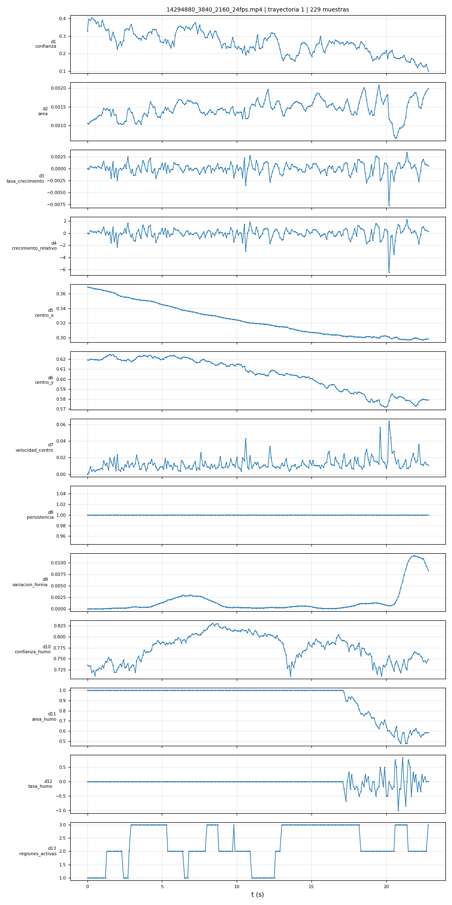

# Detección temprana y clasificación de la severidad de incendios en video mediante localización temporal

Tesis de pregrado en Ciencia de la Computación, Universidad Nacional de San Agustín de Arequipa (Perú).

- Autor: Alessander Jesús Carazas Quispe
- Asesor: Carlos Eduardo Atencio Torres

El sistema recibe un video y realiza estos pasos:
1. Detecta y sigue las regiones de fuego y humo.
2. Describe cada región con 13 descriptores.
3. Estima en cada momento la severidad del fuego con una red recurrente de tiempo continuo (CfC).

La salida se convierte en segmentos `(inicio, fin, nivel)`, es decir, en una localización temporal de los niveles de severidad, y en alertas calibradas.

**Estado:** avance del 50 %. Ya funcionan las etapas 1 a 4, desde el video hasta los descriptores. Las etapas 5 a 8 (modelo temporal, estimación de riesgo, calibración y salida) corresponden al avance del 80 %.


*Figura 4.1 de la tesis. En verde, lo implementado en este avance; en gris, lo que corresponde al avance del 80 %.*

## Evolución desde el avance del 30 %

El avance del 30 % (rama [`avance-30`](https://github.com/AlessanderLCarazas/tesis-severidad-incendios/tree/avance-30)) tenía solo la detección y los datos preparados:


*La misma figura marcada para el avance del 30 %: en verde, solo la detección de fuego y humo.*

| Componente | Avance 30 % | Avance 50 % |
|---|---|---|
| Etapas 1 y 2: entrada y preprocesamiento | sin implementar | lector con marca de tiempo real, `dt_k` y muestreo a unos 10 fps |
| Etapa 3: detección | YOLOv8s entrenado y evaluado (mAP50 0.867) | el mismo detector |
| Etapa 3: seguimiento | sin implementar | ByteTrack por clase, Kalman con `dt` real (tope de 2 periodos) y compensación de la cámara |
| Etapa 4: movimiento de la cámara | sin implementar | Shi-Tomasi, Lucas-Kanade y similitud con RANSAC |
| Etapa 4: descriptores | sin implementar | 13 descriptores por trayectoria y muestra |
| Etiquetado de la severidad | curvas de área con reglas y herramienta manual | etiquetas con IA en 200 videos y validación humana a ciegas en 40 (acuerdo 85 %, kappa 0.80) |
| Evidencias | métricas del detector | demos en video, pruebas del filtro de Kalman y de la cámara, figuras del etiquetado |

Los cambios exactos de código entre los dos avances se ven en la [comparación de ramas `avance-30...avance-50`](https://github.com/AlessanderLCarazas/tesis-severidad-incendios/compare/avance-30...avance-50).

## Demo: etapas 1 a 4 sobre video

Resultado de las etapas 1 a 4 sobre dos videos completos (el detector se entrenó solo con imágenes). Las cajas muestran cada trayectoria de fuego y humo con su ID. El panel muestra el área (d2), la tasa de crecimiento (d3) y el área de humo (d11) de la región principal (la trayectoria de fuego de mayor área en cada instante).

**Fuego controlado (vela):** el área se mantiene estable y no hay humo.


*Video de [Pexels](https://www.pexels.com/video/19151618/) (ID 19151618).*

**Fuego que se propaga (basural):** el fuego avanza a lo largo de la basura y aparece humo. La cámara va en mano, así que parte de la variación del área se debe al movimiento de la cámara.


*Video del dataset DetectiumFire (arXiv:2511.02495), CC BY-NC-SA 4.0.*

## Etapas implementadas

Para cada etapa se indica qué se aplica, en el orden en que se ejecuta, y la evidencia de que funciona. Los números salen de [`resultados/REPORTE.md`](resultados/REPORTE.md) y de los CSV de `resultados/`.

### Etapa 1: Entrada (`preprocesamiento.py`)

1. **Lectura del video:** se abre con OpenCV (`cv2.VideoCapture`) y se recorre fotograma a fotograma.
2. **Marca de tiempo real:** de cada fotograma se lee su instante `t_k` (`CAP_PROP_POS_MSEC`), sin suponer un fps fijo.
3. **Corrección de marcas:** si una marca no avanza respecto a la anterior, se le suma un periodo del video, para que el tiempo siempre crezca.

La salida es la secuencia `V = {(I_k, t_k)}`: cada fotograma con su instante.

### Etapa 2: Preprocesamiento (`preprocesamiento.py`)

1. **Muestreo a unos 10 fps:** se toma el fotograma más cercano a cada punto de una rejilla de 100 ms; los demás se saltan sin decodificarlos.
2. **Intervalo de tiempo:** `dt_k = t_k - t_{k-1}` entre muestras consecutivas, con las marcas reales.
3. **Redimensión:** a 640x640 con relleno (letterbox), conservando la proporción.
4. **Normalización:** píxeles a [0, 1].

Los pasos 3 y 4 los aplica Ultralytics al pasar la imagen al detector.

**Evidencia.** En un video a 25 fps, 500 fotogramas quedan en 200 muestras, y `dt_k` alterna entre 80 y 120 ms (media 100.1 ms), porque la rejilla de 40 ms del archivo no divide los 100 ms. Por eso el sistema trabaja con el `dt_k` real y no con un periodo fijo.


### Etapa 3: Detección y seguimiento (`seguimiento.py`)

En cada muestra se aplica, en orden:

1. **Detección (YOLOv8s):** cajas de fuego y de humo con su confianza (entrada de 640, confianza mínima 0.1).
2. **Un seguidor por clase:** las detecciones de fuego y las de humo van a dos ByteTrack separados.
3. **División por confianza (ByteTrack):** detecciones de alta confianza (0.25 o más) y de baja confianza (entre 0.1 y 0.25).
4. **Predicción del filtro de Kalman:** cada trayectoria predice su caja en la muestra actual. La matriz de transición usa `dt_rel = min(dt_k / 0.1 s, 2)`, y el ruido de proceso se escala con el mismo factor.
5. **Compensación de la cámara:** las cajas predichas se mueven con la similitud estimada en la etapa 4, como en BoT-SORT.
6. **Primera asociación:** trayectorias contra detecciones de alta confianza, por IoU ponderada por la confianza, con el algoritmo húngaro.
7. **Segunda asociación:** las trayectorias que quedaron sin pareja contra las detecciones de baja confianza, por IoU.
8. **Corrección del filtro de Kalman:** cada trayectoria emparejada actualiza su estado con su detección.
9. **Altas y bajas:** una detección de alta confianza sin pareja inicia una trayectoria nueva; una trayectoria sin detección se conserva 30 muestras (unos 3 s) y luego se elimina.

**Evidencia 1: detector.** YOLOv8s preentrenado en COCO, entrenado 30 épocas con el subconjunto CV de FASDD más las imágenes sin fuego de DetectiumFire. Resultados en la partición de prueba:

| mAP50 | mAP50-95 | Precisión | Recall | AP50 fuego | AP50 humo |
|---|---|---|---|---|---|
| 0.867 | 0.616 | 0.87 | 0.766 | 0.881 | 0.853 |

Salida completa de la evaluación: [`resultados/detector_prueba.txt`](resultados/detector_prueba.txt).

**Evidencia 2: seguimiento en video.** Los dos videos de la sección [Demo](#demo-etapas-1-a-4-sobre-video).

**Evidencia 3: variantes del filtro de Kalman** (fuego, suma de 4 videos de prueba). Con todos los fotogramas, `dt_k` casi no varía y las cuatro variantes coinciden. Al quitar el 50 % de los fotogramas, el `dt` real sin tope extrapola la velocidad ruidosa de la llama y corta más trayectorias; con un tope de 2 periodos queda con menos cortes que el original.

| Variante | Todos los fotogramas: trayectorias / cortes | Quitando el 50 %: trayectorias / cortes |
|---|---|---|
| original (`dt` = 1) | 114 / 26 | 62 / 9 |
| `dt` real | 114 / 26 | 68 / 13 |
| `dt` real con tope 2 (sistema) | 114 / 26 | 64 / 7 |
| `dt` solo en el ruido de proceso | 114 / 26 | 60 / 8 |

### Etapa 4: Representación de características (`camara.py`, `descriptores.py`)

**A. Movimiento de la cámara**, entre cada par de muestras:

1. **Preparación:** la imagen pasa a escala de grises y se reduce a 960 px de ancho.
2. **Máscara:** se excluyen las cajas de fuego, porque el fuego se mueve por sí mismo y no sirve para medir la cámara. El humo no se excluye: sus puntos los descarta RANSAC como valores atípicos.
3. **Shi-Tomasi:** elige hasta 400 esquinas en la zona permitida.
4. **Lucas-Kanade piramidal:** sigue esas esquinas hasta la muestra siguiente.
5. **Similitud con RANSAC:** ajusta escala `s`, rotación y traslación `(tx, ty)`, y descarta los puntos que no la cumplen (umbral de 3 px, confianza 0.99).
6. **Validación:** la estimación se acepta si hay al menos 10 puntos y 50 % de inliers; si no, se toma la cámara como quieta.

**B. Descriptores**, por cada trayectoria de fuego y muestra:

1. **De la caja:** confianza (d1), área relativa (d2) y centro (d5-d6).
2. **Con la escala `s` y `dt_k`:** tasa de crecimiento compensada (d3) y crecimiento relativo (d4).
3. **Con la traslación de la cámara:** velocidad del centro compensada (d7).
4. **En una ventana de 3 s:** persistencia (d8) y variación de forma (d9).
5. **Con el humo en una región 2 veces mayor que la caja:** confianza de humo (d10), área de humo (d11) y su tasa de cambio (d12).
6. **De la escena:** regiones de fuego activas (d13).

La salida en cada muestra es la matriz `X_t` de N trayectorias por 13 descriptores. Las definiciones están en la tabla [Los 13 descriptores](#los-13-descriptores-cuadro-44-de-la-tesis).

**Evidencia 1: compensación de la cámara.** Con los puntos fuera de las cajas de fuego, los cortes bajan de 26 (sin compensar) a 19; con los puntos fuera de todas las cajas, solo a 25.

| Seguimiento (fuego, 4 videos, todos los fotogramas) | Trayectorias | Cortes | Cortas | Cobertura media |
|---|---|---|---|---|
| sin compensar | 114 | 26 | 24 | 0.551 |
| compensando, puntos fuera de todas las cajas | 114 | 25 | 19 | 0.560 |
| compensando, puntos fuera de las cajas de fuego (sistema) | 106 | 19 | 17 | 0.564 |

**Evidencia 2: movimiento estimado.** Traslación, escala e inliers en un video tomado desde un dron, con un alejamiento de zoom hacia los 13 s. En rojo, las muestras descartadas (menos de 10 puntos o menos de 50 % de inliers).


**Evidencia 3: descriptores.** Los 13 descriptores de una trayectoria de fuego en un video aéreo. El centro se desplaza en la imagen por el paneo de la cámara, mientras que la velocidad compensada (d7) queda cerca de 0.



### Etiquetado de la severidad (subproceso que prepara los datos de la CfC)

Para cada video se registran el nivel inicial, los instantes de cambio a Incipiente y a Incontrolado, y el tramo útil. Un cambio cuenta solo si el nuevo nivel se mantiene al menos 2 s. Las etiquetas de entrenamiento las genera una IA, y 40 videos pasan por una validación humana a ciegas.

Se aplica, en orden:

1. **Curva de área (`preanotar.py`):** YOLOv8s recorre el video a 5 fps y mide el área de fuego y de humo en cada fotograma, suavizada con una mediana de 1 s.
2. **Propuesta por reglas (`preanotar.py`):** con la línea base `a0` (fuego) y `h0` (humo) de los primeros 2 s, el video empieza Incontrolado si `a0` es 0.25 o más o `h0` es 0.4 o más; pasa a Incipiente cuando el área supera `max(2·a0, a0 + 0.02)` durante 2 s. Las propuestas inestables se marcan como dudosas, con su motivo.
3. **Tira de 24 fotogramas (`generar_tiras.py`):** fotogramas equiespaciados del video, en una imagen de 6 columnas.
4. **Etiquetado con IA (`etiquetar_ia.py`):** subagentes de Claude (Sonnet) con un prompt fijo (`prompts/prompt_severidad.txt`) ven solo la tira y responden en JSON con el nivel inicial y el número de foto de cada cambio. Se valida cada respuesta y las fotos se convierten a segundos. Las respuestas crudas están en `resultados/ia_crudo/`.
5. **Validación humana a ciegas (`etiquetar_v2.py --ciego`):** 40 videos se etiquetan a mano a partir de la misma tira, sin ver la propuesta de las reglas ni la respuesta de la IA.
6. **Comparación (`comparar_etiquetas.py`):** acuerdo y kappa ponderado entre la validación humana y la IA.

**Evidencia a: curva de área y propuesta por reglas.** Esta propuesta se marcó como dudosa porque el área varía mucho.


**Evidencia b: tira de 24 fotogramas y respuesta de la IA.** La IA responde con números de foto, que luego se convierten a segundos. Este video está entre los 40 con validación humana: la IA y la validación humana coinciden en Incipiente.


*Video del dataset DetectiumFire (arXiv:2511.02495), CC BY-NC-SA 4.0.*

**Evidencia c: herramienta de etiquetado a ciegas.** Así se ve `etiquetar_v2.py --ciego`: sin propuesta ni curva, renderizada desde el código con la etiqueta guardada en la validación humana (borde amarillo: incipiente; verde: controlado).


*Videos del dataset DetectiumFire (arXiv:2511.02495), CC BY-NC-SA 4.0, y de [Pexels](https://www.pexels.com/video/19151618/) (vela, ID 19151618).*

**Evidencia d: la IA contra la validación humana.** Nivel inicial de los 40 videos con validación humana a ciegas. El acuerdo es de 85 % (kappa ponderado lineal 0.80).


**Evidencia e: conteos.** 200 videos etiquetados por la IA, 40 con validación humana, 1 707 curvas de área y 218 candidatos con crecimiento sostenido para el avance del 80 %.

## Niveles de severidad

Los tres niveles agrupan los de DetectiumFire: sin riesgo → Controlado; riesgo bajo y medio → Incipiente; riesgo alto → Incontrolado.

| Nivel | Definición |
|---|---|
| Controlado | la llama permanece en su fuente (vela, cocina, fogata delimitada) y su tamaño es estable |
| Incipiente | el fuego sale de su fuente o crece de forma sostenida, pero afecta a un solo objeto o a una superficie reducida |
| Incontrolado | el fuego involucra varios objetos o una superficie extensa, o el humo denso ocupa gran parte de la escena |

## Resumen del pipeline

| Etapa | Qué hace | Estado | Script |
|---|---|---|---|
| 1. Entrada | video `V = {(I_k, t_k)}`: cada fotograma llega con su marca de tiempo | implementada | `preprocesamiento.py` |
| 2. Preprocesamiento | marca de tiempo `t_k` y `dt_k = t_k - t_{k-1}`; muestreo a unos 10 fps conservando la marca real; redimensión a 640x640 con relleno y normalización a [0, 1] | implementada | `preprocesamiento.py` |
| 3. Detección y seguimiento | YOLOv8s detecta fuego y humo, y ByteTrack forma las trayectorias con Kalman (`dt_k` real con tope de 2 periodos) y compensación de la cámara | implementada | `seguimiento.py` |
| 4. Representación de características | movimiento de la cámara (Shi-Tomasi, Lucas-Kanade y similitud con RANSAC) y 13 descriptores por trayectoria y fotograma | implementada | `camara.py`, `descriptores.py` |
| 5. Procesamiento temporal | compuerta multiplicativa con el contexto de la cámara y `dt_k`, y red CfC con `timespans = dt_k` | avance del 80 % | |
| 6. Estimación de riesgo | severidad (CORAL), riesgo continuo y tiempo al peligro | avance del 80 % | |
| 7. Calibración y decisión | umbral de alerta con predicción conformal por video e histéresis | avance del 80 % | |
| 8. Salida | nivel, alerta, tiempo al peligro, caja de la región y segmentos `(t_s, t_e, nivel)` | avance del 80 % | |

### Los 13 descriptores (Cuadro 4.4 de la tesis)

| Grupo | N.º | Descriptor | Definición |
|---|---|---|---|
| Detección | 1 | Confianza | confianza de la detección de fuego |
| Tamaño y crecimiento | 2 | Área | `A_k` = área de la caja / área del fotograma |
| | 3 | Tasa de crecimiento | `(A_k - s_k^2 A_{k-1}) / dt_k` |
| | 4 | Crecimiento relativo | tasa de crecimiento / `A_k` |
| Posición y movimiento | 5-6 | Centro | `(x_k, y_k)` normalizado de la caja |
| | 7 | Velocidad del centro | desplazamiento compensado por la cámara / `dt_k` |
| Comportamiento en el tiempo | 8 | Persistencia | fracción de los últimos 3 s con detección |
| | 9 | Variación de forma | varianza de la relación de aspecto en 3 s |
| Humo | 10 | Confianza de humo | máxima confianza de humo cerca de la caja (región ampliada 2 veces) |
| | 11 | Área de humo | área de humo en esa región |
| | 12 | Tasa del humo | cambio del área de humo / `dt_k` |
| Escena | 13 | Regiones activas | trayectorias de fuego activas |

## Instalación

Probado en Windows 11 con Python 3.10, PyTorch 2.5.1 con CUDA 12.1 y una GPU NVIDIA RTX 3050 Ti de 4 GB.

```
pip install -r requirements.txt
```

## Datos y pesos (no incluidos en el repositorio)

| Recurso | Uso | Ubicación esperada |
|---|---|---|
| FASDD, subconjunto CV | entrenar y evaluar el detector | `FASDD/`, convertido a `FASDD_yolo/` con `preparar_fasdd.py` |
| DetectiumFire (imágenes sin fuego y videos) | negativos del detector; videos para el modelo temporal | `real_images/`, `real_video/real_video/fire` y `real_video/real_video/non_fire` |
| Pesos del detector | todas las etapas | `runs_fuego/fasdd_v8s_full/weights/best.pt` (se generan con `entrenar_yolo.py`) |

## Uso

```
python entrenar_yolo.py --modelo yolov8s.pt --epocas 30 --batch 8
python preanotar.py --limite 200
python preprocesamiento.py
python seguimiento.py
python camara.py
python descriptores.py
python demo.py --crecimiento 12487581_1920_1080_30fps.mp4
python figuras_readme.py
```

Cada script usa `argparse` con valores por defecto razonables; ejecuta `python <script>.py --help` para ver sus opciones.

| Script | Qué hace |
|---|---|
| `preparar_fasdd.py`, `revisar_fasdd.py` | arman y verifican el conjunto YOLO de FASDD con los negativos de DetectiumFire |
| `entrenar_yolo.py`, `probar_yolo.py` | entrenan y prueban el detector |
| `seleccionar_videos.py`, `generar_tiras.py` | seleccionan videos y generan las tiras de 24 fotogramas |
| `preanotar.py`, `listar_sin_curva.py` | curva de área por video y propuestas de etiqueta con reglas |
| `etiquetar.py`, `etiquetar_v2.py` | herramientas de etiquetado manual (`--ciego` para la validación a ciegas) |
| `etiquetar_ia.py`, `comparar_etiquetas.py` | lotes y unión de las etiquetas de IA, y comparación humano contra IA |
| `preprocesamiento.py` | lector de video con marcas de tiempo reales, `dt` y muestreo a 10 fps |
| `seguimiento.py` | detección y ByteTrack con `dt` real y compensación de cámara |
| `camara.py` | movimiento de la cámara y su efecto en el seguimiento |
| `descriptores.py` | los 13 descriptores por trayectoria y fotograma |
| `demo.py` | videos y GIF de demostración |
| `figuras_readme.py` | figuras y tablas de las evidencias |

## Créditos y licencia de las imágenes

- **Vela (demo de fuego controlado y última captura de la herramienta):** video de [Pexels](https://www.pexels.com/video/19151618/) (ID 19151618), bajo la [licencia de Pexels](https://www.pexels.com/license/).
- **Las demás imágenes con fotogramas de video:** dataset DetectiumFire ([arXiv:2511.02495](https://arxiv.org/abs/2511.02495)), cuyos videos de búsqueda web se publican bajo [CC BY-NC-SA 4.0](https://creativecommons.org/licenses/by-nc-sa/4.0/). Se usan con fines académicos y no comerciales.
- **Las imágenes y los GIF de este README** se comparten bajo [CC BY-NC-SA 4.0](https://creativecommons.org/licenses/by-nc-sa/4.0/).
- **Criterio de selección:** los fotogramas publicados no tienen marcas de agua, logos de canales o noticieros, texto superpuesto ni caras reconocibles.
- Las gráficas sin fotogramas son de elaboración propia.

## Ramas

| Rama | Contenido |
|---|---|
| `avance-30` | avance del 30 %: detector entrenado y datos preparados (congelada, tag `v0.3`) |
| `avance-50` | avance del 50 %: etapas 1 a 4, del video a los descriptores (congelada, tag `v0.5`) |
| `avance-80` | avance del 80 %: etapas 5 a 8 (en desarrollo) |
| `main` | desarrollo desde el 80 % hasta la versión final |
