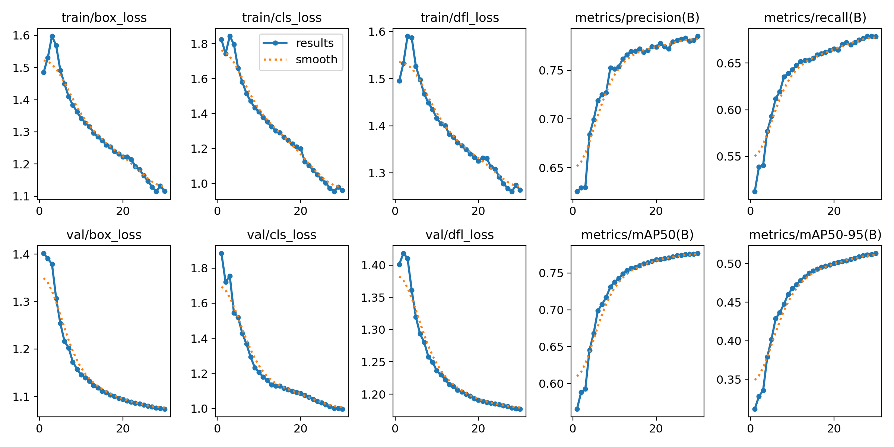
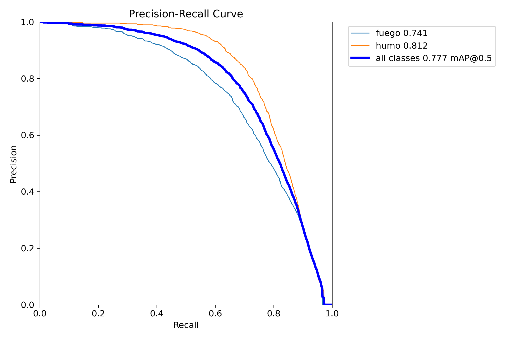
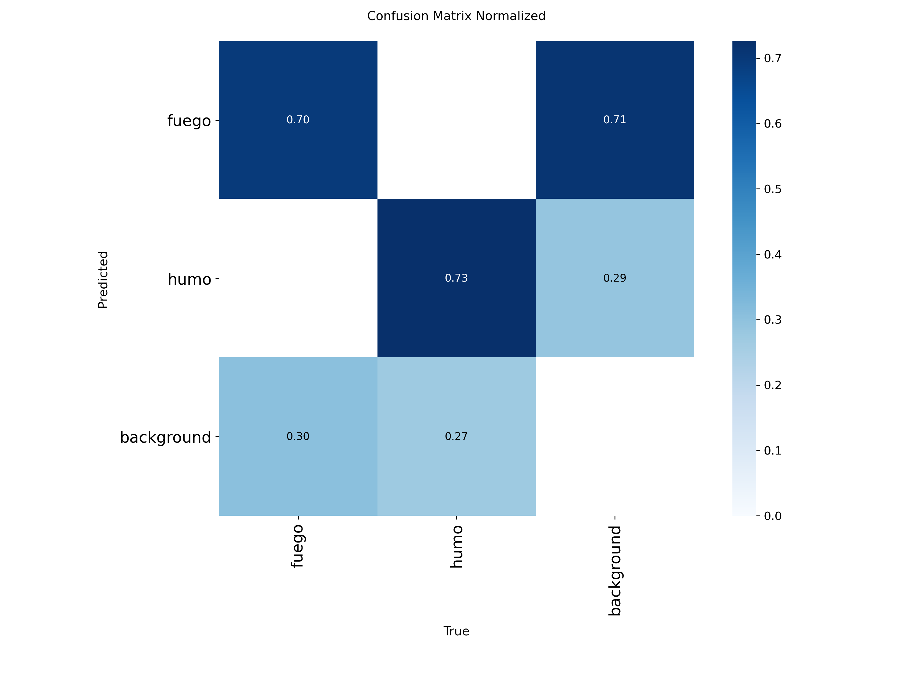
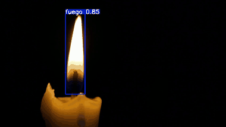

# Detección temprana y clasificación de la severidad de incendios en video mediante localización temporal

Tesis de pregrado en Ciencia de la Computación, Universidad Nacional de San Agustín de Arequipa (Perú).

- Autor: Alessander Jesús Carazas Quispe
- Asesor: Carlos Eduardo Atencio Torres

El sistema recibe un video y realiza estos pasos:
1. Detecta y sigue las regiones de fuego y humo.
2. Describe cada región con 13 descriptores.
3. Estima en cada momento la severidad del fuego con una red recurrente de tiempo continuo (CfC).

La salida se convierte en segmentos `(inicio, fin, nivel)`, es decir, en una localización temporal de los niveles de severidad, y en alertas calibradas.

**Estado:** avance del 30 %. Esta rama guarda el código del primer commit del proyecto (4 de noviembre de 2026), antes de implementar el avance del 50 %. Ya funciona la detección de fuego y humo, y los datos están preparados para el etiquetado. El avance siguiente está en la rama [`avance-50`](https://github.com/AlessanderLCarazas/tesis-severidad-incendios/tree/avance-50).

*Figura 4.1 de la tesis marcada para el avance del 30 %. En verde, lo implementado: la detección de fuego y humo (el seguimiento, en gris, todavía no). En gris claro, lo que se implementa en el avance del 50 %; en gris oscuro, lo del avance del 80 %.*

## Qué se implementó

### Detector de fuego y humo (etapa 3, solo la detección)

Se aplica, en orden:

1. **Preparación de FASDD (`preparar_fasdd.py`):** se toma el subconjunto CV de FASDD con las anotaciones en formato YOLO que trae el propio dataset, se organiza en la estructura de carpetas de YOLOv8 (con enlaces duros) y se escribe `data.yaml` con dos clases: fuego y humo.
2. **Negativos (`preparar_fasdd.py`):** se agregan imágenes sin fuego de DetectiumFire, para que el detector aprenda escenas que no debe marcar; el 15 % de ellas va a validación.
3. **Revisión de las particiones (`revisar_fasdd.py`):** se comprueba que las imágenes de entrenamiento, validación y prueba existan, que no haya repetidas y que ninguna se comparta entre particiones, para evitar fuga de datos.
4. **Entrenamiento (`entrenar_yolo.py`):** YOLOv8s preentrenado en COCO, ajustado 30 épocas con imágenes de 640.
5. **Evaluación (`entrenar_yolo.py`):** métricas en las particiones completas de validación y prueba, al terminar el entrenamiento o con `--evaluar`.
6. **Pruebas (`probar_yolo.py`):** el detector sobre un video, una imagen, una carpeta o la cámara web, con el número de cuadros con fuego y con humo y la velocidad.

**Evidencia 1: resultados en la partición de prueba.**

| mAP50 | mAP50-95 | Precisión | Recall | AP50 fuego | AP50 humo |
|---|---|---|---|---|---|
| 0.867 | 0.616 | 0.87 | 0.766 | 0.881 | 0.853 |

Salida completa de la evaluación (15 884 imágenes de prueba): [`resultados/detector_prueba.txt`](resultados/detector_prueba.txt).

*Pérdidas y métricas en las 30 épocas, medidas en la validación usada durante el entrenamiento (5 000 imágenes).*

*Curva precisión-recall al final del entrenamiento en esa validación: mAP50 0.777 (fuego 0.741, humo 0.812).*

*Matriz de confusión normalizada en esa validación: se detecta con su clase el 70 % del fuego y el 73 % del humo; el 71 % de las falsas detecciones sobre el fondo son de fuego.*

**Evidencia 2: preentrenamiento en COCO contra entrenar desde cero** (10 % de los datos, 10 épocas, partición de prueba).

| Inicialización | mAP50 | AP50 humo |
|---|---|---|
| preentrenado en COCO | 0.562 | 0.406 |
| desde cero | 0.421 | 0.245 |

**Evidencia 3: velocidad.** 8.2 ms por imagen en la partición de prueba (0.7 de preprocesamiento + 6.7 de inferencia + 0.8 de postproceso, ver [`resultados/detector_prueba.txt`](resultados/detector_prueba.txt)) y unos 24 cuadros por segundo de punta a punta sobre el video 1080p de la vela, con una GPU RTX 3050 Ti de 4 GB.

**Evidencia 4: detección en video.**

*Detección cuadro a cuadro con el código y los pesos de esta rama (sin seguimiento). Video de Pexels (ID 19151618).*

### Análisis y selección de los videos de DetectiumFire

Se aplica, en orden:

1. **Inventario (`inspeccionar_data.py`, `analizar_detectiumfire.py`):** se cuentan las imágenes, los videos y las anotaciones del dataset, y se miden la duración, los fps y la resolución de cada video (`metadatos_videos.csv`).
2. **Agrupación por origen (`analizar_detectiumfire.py`, `seleccionar_videos.py`):** el origen de cada clip se deduce de su nombre y los clips que salen de un mismo video original se agrupan, para luego poder partir los datos por origen.
3. **Selección (`seleccionar_videos.py`):** se eligen hasta 400 videos de fuego de al menos 5 s, recorriendo los orígenes de mayor a menor duración total y tomando un clip por origen en cada ronda (como máximo 6 por origen); el 20 % de los orígenes se marca para un segundo anotador (`seleccion_etiquetado.csv`).
4. **Tiras de 24 fotogramas (`generar_tiras.py`):** fotogramas equiespaciados de cada video en una sola imagen, para revisar el video de un vistazo.

### Preparación del etiquetado de severidad

Se aplica, en orden:

1. **Curvas de área (`preanotar.py`):** YOLOv8s recorre cada video y mide el área de fuego y de humo en el tiempo.
2. **Propuesta por reglas (`preanotar.py`):** a partir de la curva se proponen el nivel inicial y el instante de crecimiento.
3. **Herramienta manual (`etiquetar.py`):** reproduce el video y permite marcar el nivel inicial, los instantes de cambio y el tramo útil.

## Pendiente para el avance del 50 %

- Lector de video con marca de tiempo real y `dt` (etapas 1 y 2).
- Seguimiento con ByteTrack, filtro de Kalman con `dt` real y compensación de la cámara (resto de la etapa 3).
- Movimiento de la cámara y los 13 descriptores (etapa 4).
- Etiquetado con IA y validación humana a ciegas.

## Niveles de severidad

Los tres niveles agrupan los de DetectiumFire: sin riesgo → Controlado; riesgo bajo y medio → Incipiente; riesgo alto → Incontrolado.

| Nivel | Definición |
|---|---|
| Controlado | la llama permanece en su fuente (vela, cocina, fogata delimitada) y su tamaño es estable |
| Incipiente | el fuego sale de su fuente o crece de forma sostenida, pero afecta a un solo objeto o a una superficie reducida |
| Incontrolado | el fuego involucra varios objetos o una superficie extensa, o el humo denso ocupa gran parte de la escena |

## Scripts de esta rama

| Script | Qué hace |
|---|---|
| `inspeccionar_data.py`, `analizar_detectiumfire.py` | inventario del dataset DetectiumFire y metadatos de los videos |
| `preparar_fasdd.py`, `revisar_fasdd.py` | arman y verifican el conjunto YOLO de FASDD con los negativos de DetectiumFire |
| `entrenar_yolo.py`, `probar_yolo.py` | entrenan y prueban el detector |
| `seleccionar_videos.py`, `generar_tiras.py` | seleccionan videos y generan las tiras de 24 fotogramas |
| `preanotar.py` | curva de área por video y propuesta de etiqueta con reglas |
| `etiquetar.py` | herramienta de etiquetado manual |
| `metadatos_videos.csv` | duración, fps, resolución y origen de cada video de DetectiumFire |
| `seleccion_etiquetado.csv` | los videos elegidos para el etiquetado |

## Datos y pesos (no incluidos en el repositorio)

| Recurso | Uso | Ubicación esperada |
|---|---|---|
| FASDD, subconjunto CV | entrenar y evaluar el detector | `FASDD/`, convertido a `FASDD_yolo/` con `preparar_fasdd.py` |
| DetectiumFire (imágenes sin fuego y videos) | negativos del detector; videos para el etiquetado | `real_images/`, `real_video/real_video/fire` y `real_video/real_video/non_fire` |
| Pesos del detector | evaluación y preanotación | `runs_fuego/fasdd_v8s_full/weights/best.pt` (se generan con `entrenar_yolo.py`) |

## Créditos de las imágenes

- **Vela (`docs/img/detector_vela.gif`):** video de [Pexels](https://www.pexels.com/video/19151618/) (ID 19151618), bajo la [licencia de Pexels](https://www.pexels.com/license/).
- Las gráficas del detector (`docs/img/detector/`) son salidas de Ultralytics del entrenamiento propio y no contienen fotografías.

## Ramas

| Rama | Contenido |
|---|---|
| `avance-30` | avance del 30 %: detector entrenado y datos preparados (congelada, tag `v0.3`) |
| `avance-50` | avance del 50 %: etapas 1 a 4, del video a los descriptores (congelada, tag `v0.5`) |
| `avance-80` | avance del 80 %: etapas 5 a 8 (en desarrollo) |
| `main` | desarrollo desde el 80 % hasta la versión final |
