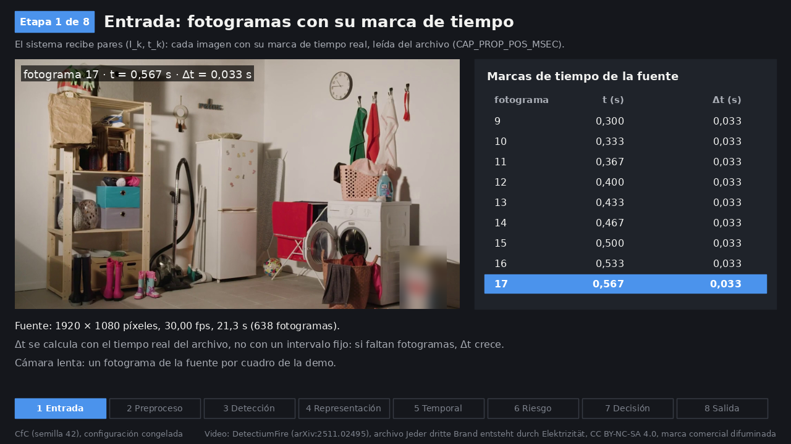
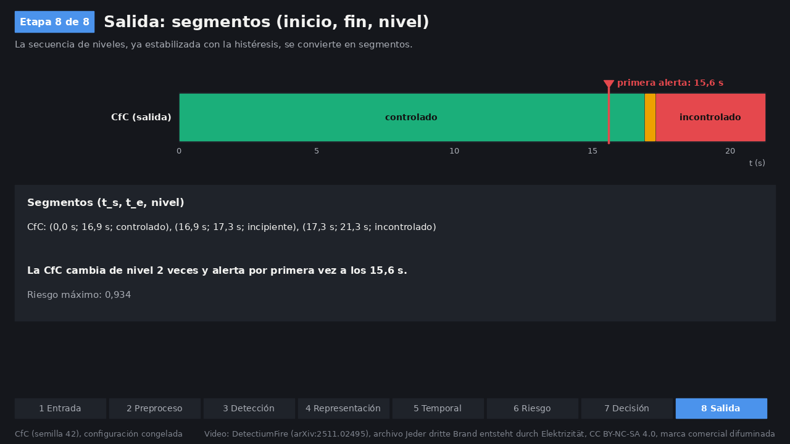

# Demo paso a paso: las 8 etapas del sistema

Un video de calibración, no usado para entrenar ni para fijar el umbral, pasa por las 8 etapas del sistema con la CfC congelada (semilla 42). Ejemplo elegido para mostrar cómo trabaja cada etapa; no representa el desempeño promedio (ver [Resultados](../../README.md#resultados-en-la-prueba)).

## Etapa 1. Entrada

El sistema recibe cada fotograma con su marca de tiempo real, leída del archivo. El video tiene 30 fps, así que Δt vale 0,033 s; si faltaran fotogramas, Δt crecería y el sistema lo usaría tal cual.

## Etapa 2. Preprocesamiento

Se procesa uno de cada tres fotogramas, unos 10 por segundo, y cada uno conserva su marca real, por lo que Δt pasa a 0,100 s. Antes de YOLO, la imagen se lleva a 640 × 384 píxeles con un relleno gris mínimo, y sus valores se dividen entre 255.

## Etapa 3. Detección y seguimiento

YOLOv8s encuentra el fuego y el humo en cada fotograma, y ByteTrack une las detecciones de una misma región en una trayectoria con su identificador. A los 7,7 s hay una trayectoria de fuego, la 8, con confianza 0,71 y 1,7 s de edad. En este video no hay cortes de escena.

## Etapa 4. Representación

El movimiento de la cámara se estima con puntos del fondo, fuera del fuego, que se siguen entre fotogramas; RANSAC descarta los que no se mueven con la cámara. En el cuadro que se muestra, la cámara está quieta (escala 1, sin rotación ni traslación). Con las trayectorias se arma el vector de escena de 34 valores, que es lo que recibe el modelo temporal.

## Etapa 5. Procesamiento temporal

La compuerta multiplica cada columna del vector de escena por un peso entre 0 y 1, calculado con el movimiento de la cámara y Δt (arriba, los pesos en el tiempo). Luego la CfC actualiza su estado de 64 unidades con el Δt real (abajo), y su estado cambia a medida que el fuego crece.

## Etapa 6. Estimación del riesgo

Del estado salen tres estimaciones: la probabilidad de cada nivel (CORAL), un riesgo continuo entre 0 y 1 y el tiempo que falta para el peligro. Al final del video, la probabilidad de incontrolado es 0,76.

## Etapa 7. Calibración y decisión

El nivel sale de CORAL con umbral 0,5 y solo cambia si el nuevo nivel se mantiene 2 s, para evitar el parpadeo. La alerta se enciende cuando el riesgo supera 0,813, el umbral calibrado con predicción conformal en 52 videos sin fuego o controlados, y se apaga si el riesgo se mantiene debajo de 0,650 durante 2 s. Aquí la primera alerta llega a los 15,6 s.

## Etapa 8. Salida

La secuencia de niveles, ya estabilizada, se convierte en segmentos (inicio, fin, nivel): controlado hasta los 16,9 s, incipiente hasta los 17,3 s e incontrolado hasta el final. La primera alerta llega a los 15,6 s.

## Vista completa

En vivo, la alerta y el nivel pueden no coincidir: la alerta usa el riesgo continuo y se enciende a los 15,6 s, mientras que el nivel espera 2 s para confirmar el cambio y pasa a incipiente a los 16,9 s.

---

Video: DetectiumFire (arXiv:2511.02495), archivo "Jeder dritte Brand entsteht durch Elektrizität", CC BY-NC-SA 4.0, con una marca comercial difuminada.
