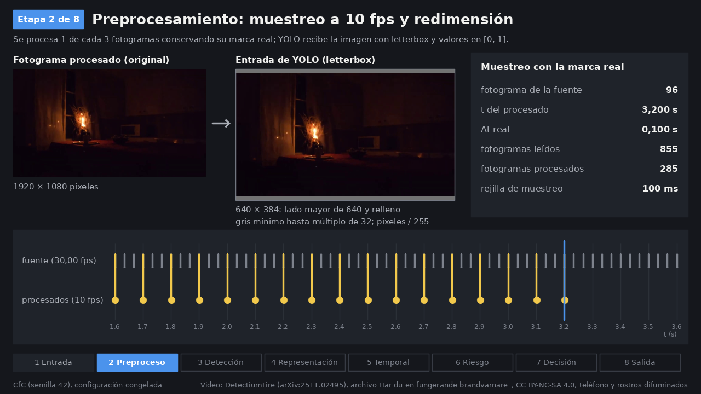
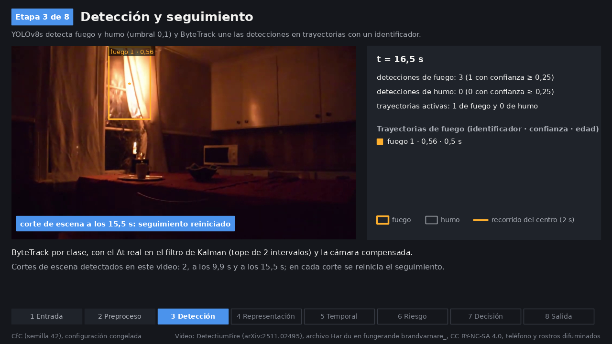
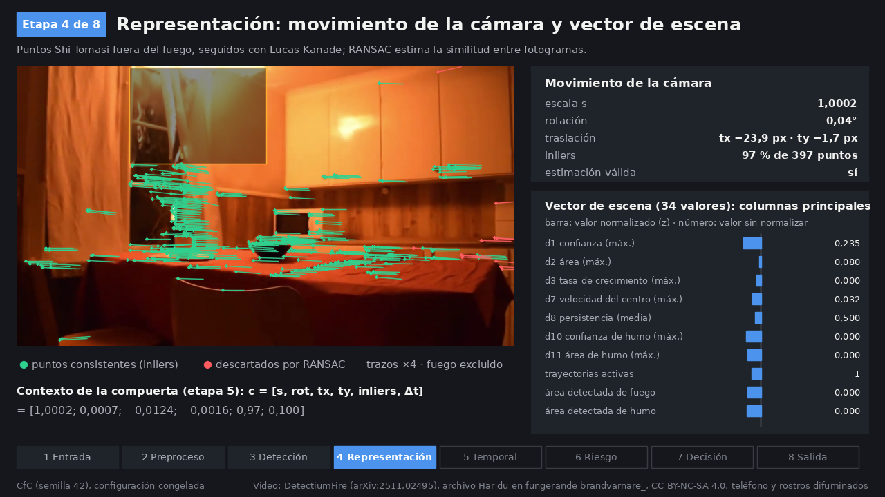
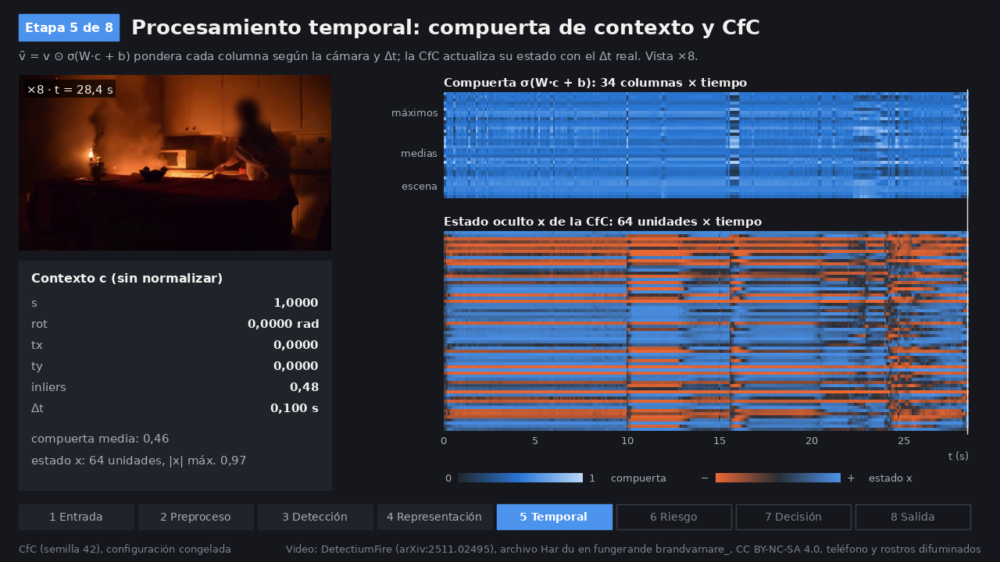
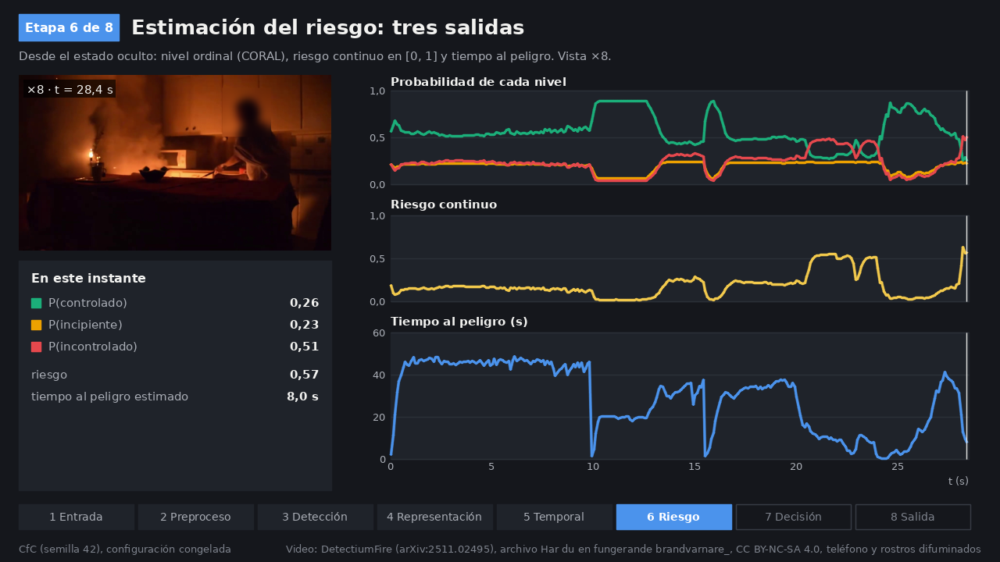
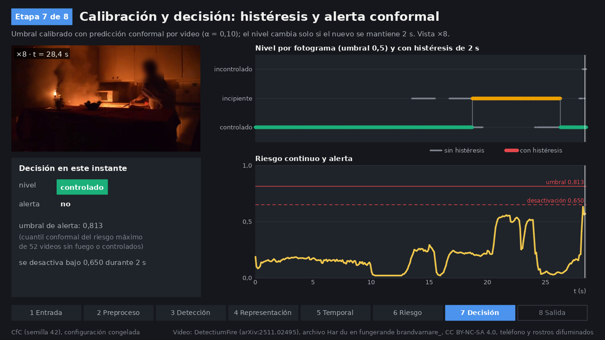
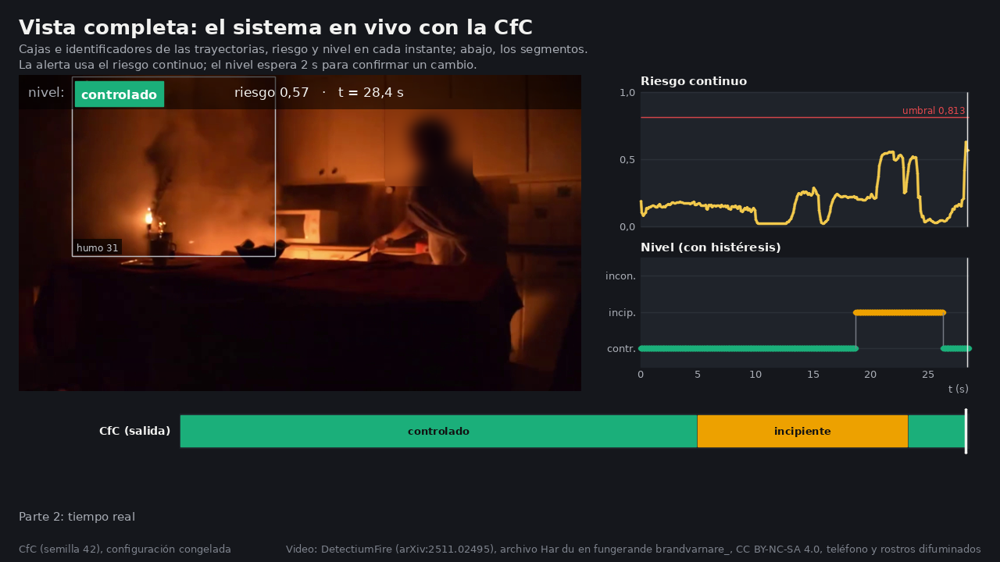

# Demo paso a paso: las 8 etapas del sistema

Un video de prueba, no usado para entrenar ni para fijar el umbral, pasa por las 8 etapas del sistema con la CfC congelada (semilla 42). Se eligió uno en que la salida de la CfC sigue bien el crecimiento del fuego; no representa el desempeño promedio (ver [Resultados](../../README.md#resultados-en-la-prueba)). El video tiene dos cortes de escena, y no hay alerta, porque el riesgo máximo, 0,633, no supera el umbral de 0,813.

## Etapa 1. Entrada

El sistema recibe el video como una secuencia de fotogramas, cada uno con su marca de tiempo real.

En la imagen:
- El fotograma 17 de la fuente, con t = 0,567 s y Δt = 0,033 s. t es el instante del fotograma, leído del archivo; Δt es el tiempo transcurrido desde el fotograma anterior, y el sistema lo usa en el seguimiento y en el modelo temporal.
- La tabla de marcas de tiempo, con el fotograma, su t y su Δt para los fotogramas 9 a 17; la fila resaltada es el fotograma actual.
- Los datos de la fuente: 1920 × 1080 píxeles, 30,00 fps, 28,5 s y 855 fotogramas.
- De dónde sale Δt: de las marcas reales del archivo (CAP_PROP_POS_MSEC), no de un intervalo fijo; si faltan fotogramas, Δt crece y el sistema lo usa tal cual.
- La nota de cámara lenta: en esta etapa, la demo avanza un fotograma de la fuente por cuadro.

## Etapa 2. Preprocesamiento

Se procesa un fotograma cada 100 ms, unos 10 por segundo, conservando su marca real, y la imagen se prepara para el detector.

En la imagen:
- El fotograma procesado, de 1920 × 1080 píxeles.
- La entrada de YOLO: la imagen con letterbox, que lleva el lado mayor a 640 píxeles y agrega el relleno gris mínimo hasta un múltiplo de 32 (640 × 384); los valores de los píxeles se dividen entre 255 para quedar entre 0 y 1.
- La tabla de muestreo: fotograma 96 de la fuente, t = 3,200 s, Δt real = 0,100 s (el tiempo real desde el fotograma procesado anterior), 855 fotogramas leídos, 285 procesados (uno de cada tres) y una rejilla de muestreo de 100 ms.
- La línea de tiempo de 1,6 a 3,6 s: arriba, los fotogramas de la fuente, uno cada 1/30 s; abajo, los procesados, uno cada 0,1 s. La línea azul marca el fotograma actual.

## Etapa 3. Detección y seguimiento

YOLOv8s busca fuego y humo en cada fotograma procesado, y ByteTrack une las detecciones de una misma región en una trayectoria con un identificador.

En la imagen (t = 16,5 s):
- La caja «fuego 1 · 0,56»: la región de la cortina en llamas, con el identificador de su trayectoria (1) y la confianza del detector (0,56, entre 0 y 1).
- El aviso «corte de escena a los 15,5 s: seguimiento reiniciado»: 1 s antes, el video cambió de toma y el sistema empezó las trayectorias de nuevo.
- El recorrido del centro, la línea naranja de los últimos 2 s: aquí es solo un punto en el centro de la caja, porque la trayectoria nació después del corte.
- Las detecciones: 3 de fuego, 1 de ellas con confianza de 0,25 o más, y 0 de humo. YOLO usa un umbral de 0,1 para no perder fuegos pequeños; solo las detecciones de 0,25 o más pueden iniciar una trayectoria, y las de 0,1 a 0,25 solo continúan una que ya existe.
- Las trayectorias activas: 1 de fuego y 0 de humo. La de fuego es la 1, con confianza 0,56 y 0,5 s de edad (el tiempo desde que nació).
- El seguimiento: ByteTrack, por separado para fuego y para humo, con el Δt real en el filtro de Kalman (que predice dónde estará cada caja), con un tope de 2 intervalos, y con la cámara compensada (las cajas se corrigen con el movimiento de la cámara).
- Los cortes de escena: 2, a los 9,9 s y a los 15,5 s; en cada corte se reinicia el seguimiento.

## Etapa 4. Representación

Se estima cuánto se movió la cámara entre fotogramas, y la escena se resume en un vector de 34 valores para el modelo temporal.

En la imagen (t = 22,6 s, durante un paneo de la cámara):
- Los puntos consistentes (inliers), en verde, 385 en este cuadro: esquinas del fondo (Shi-Tomasi) seguidas desde el fotograma anterior (Lucas-Kanade) que se mueven igual que la cámara.
- Los puntos descartados por RANSAC, en rojo, 12 en este cuadro: puntos que no siguen el movimiento común, como los que caen sobre algo que se mueve por sí mismo.
- Los trazos: el desplazamiento de cada punto, alargado 4 veces para que se vea.
- La zona del fuego excluida: el rectángulo oscurecido sobre la cortina. Ahí no se buscan puntos, porque las llamas se mueven por sí mismas.
- El movimiento de la cámara: escala s = 1,0002 (el zoom; 1 es sin zoom), rotación de 0,04°, traslación tx = −23,9 px y ty = −1,7 px (la escena se desplaza 23,9 px a la izquierda en 0,1 s), inliers del 97 % de 397 puntos (la proporción de puntos consistentes; si baja del 50 %, la estimación no se usa) y estimación válida: sí.
- Las columnas principales del vector de escena. La barra es el valor normalizado (z: cuántas desviaciones estándar se aleja del promedio del entrenamiento) y el número, el valor sin normalizar:
  - confianza máxima (d1): 0,235;
  - área máxima (d2), como fracción del fotograma: 0,080;
  - tasa de crecimiento (d3): 0,000;
  - velocidad del centro (d7): 0,032;
  - persistencia media (d8), la fracción de los últimos 3 s en que se detectó: 0,500;
  - confianza de humo (d10) y área de humo (d11): 0,000;
  - trayectorias activas: 1;
  - área detectada de fuego y de humo: 0,000. Solo cuentan las detecciones de confianza 0,25 o más, y la de este cuadro tiene 0,235.
  - El vector completo tiene el máximo y la media de d1 a d13 sobre las trayectorias, más el número de trayectorias y datos de las detecciones del fotograma.
- El vector de contexto c = [1,0002; 0,0007; −0,0124; −0,0016; 0,97; 0,100]: la escala, la rotación en radianes, las traslaciones divididas entre el ancho y el alto, la proporción de inliers y Δt. La compuerta de la etapa 5 lo usa para pesar cada columna del vector.

## Etapa 5. Procesamiento temporal

La compuerta pondera el vector de escena según el contexto, y la CfC acumula esa información en el tiempo usando el Δt real.

En la imagen (t = 28,4 s, el último cuadro; vista acelerada 8 veces):
- El contexto c sin normalizar: s = 1,0000, rot = 0,0000 rad, tx = 0,0000, ty = 0,0000, inliers = 0,48 y Δt = 0,100 s. Como los inliers no llegan al 50 %, la estimación de la cámara no es válida y se usa la identidad (sin movimiento).
- La compuerta media, 0,46: el promedio de los 34 pesos σ(W·c + b), entre 0 y 1, que multiplican cada columna del vector (ṽ = v ⊙ σ(W·c + b)). Un peso cercano a 1 deja pasar la columna; uno cercano a 0 la atenúa.
- |x| máx. = 0,97: el mayor valor absoluto del estado oculto x de la CfC, su memoria de 64 unidades, que se actualiza con el Δt real.
- El mapa de la compuerta: los 34 pesos a lo largo del tiempo, agrupados en máximos (d1 a d13), medias (d1 a d13) y escena (trayectorias y detecciones). En este video, los pesos van de 0,07 a 0,96.
- El mapa del estado oculto x: sus 64 unidades a lo largo del tiempo. Los cambios bruscos a los 9,9 s y a los 15,5 s son los cortes de escena, en los que el estado vuelve a cero.
- Las escalas de color: la compuerta va de 0 (oscuro) a 1 (claro), y el estado x, de negativo (naranja) a positivo (azul).

## Etapa 6. Estimación del riesgo

Del estado oculto salen tres estimaciones: el nivel, un riesgo continuo y el tiempo que falta para el peligro.

En la imagen (t = 28,4 s):
- Las probabilidades de cada nivel en este instante: P(controlado) = 0,26, P(incipiente) = 0,23 y P(incontrolado) = 0,51. Salen de CORAL, una salida que respeta el orden de los niveles.
- El riesgo en este instante: 0,57, un valor entre 0 y 1 que usa la alerta.
- El tiempo al peligro estimado: 8,0 s, lo que según el modelo falta para llegar a incontrolado.
- Las tres curvas, desde el inicio hasta este instante: las probabilidades de cada nivel, el riesgo continuo (con su máximo, 0,633, a los 28,2 s) y el tiempo al peligro.

## Etapa 7. Calibración y decisión

El nivel se estabiliza con histéresis, y la alerta compara el riesgo con un umbral calibrado.

En la imagen (t = 28,4 s):
- La decisión en este instante: nivel controlado y alerta «no».
- El umbral de alerta, 0,813: el cuantil conformal del riesgo máximo de 52 videos de calibración sin fuego o controlados, elegido para que, en ese tipo de videos, la probabilidad de alertar en falso sea a lo sumo del 10 % (α = 0,10).
- La desactivación: una alerta encendida se apaga si el riesgo se mantiene debajo de 0,650 (0,8 veces el umbral) durante 2 s.
- La primera alerta: no aparece, porque el riesgo nunca llega a 0,813.
- El nivel por fotograma. Sin histéresis (gris) es el nivel que sale de CORAL con umbral 0,5 en cada fotograma; con histéresis (en color), el nivel solo cambia si el nuevo se mantiene 2 s.
  - El nivel por fotograma está en incipiente o más desde los 16,7 s, y la histéresis lo confirma a los 18,7 s.
  - Vuelve a controlado a los 24,3 s, y se confirma a los 26,3 s.
  - Al final salta a incipiente e incontrolado durante menos de 1 s, y el nivel no cambia.
- El riesgo continuo, con el umbral (línea continua, 0,813) y la desactivación (línea discontinua, 0,650). Abajo iría la franja de alerta activa, que aquí queda vacía.

## Etapa 8. Salida

La secuencia de niveles, ya estabilizada, se convierte en segmentos (inicio, fin, nivel), que son la salida del sistema.

En la imagen:
- La barra de segmentos de la CfC: controlado (verde), incipiente (naranja) y otra vez controlado. No lleva marca de primera alerta, porque no hubo alerta.
- La lista de segmentos (t_s, t_e, nivel): (0,0 s; 18,7 s; controlado), (18,7 s; 26,3 s; incipiente) y (26,3 s; 28,5 s; controlado).
- El resumen: «La CfC cambia de nivel 2 veces y no alerta.», con un riesgo máximo de 0,633.

## Vista completa

Todo el sistema en tiempo real, como lo vería quien observa el video mientras avanza.

En la imagen (t = 28,4 s, el cuadro final):
- El fotograma con sus cajas: la de humo, «humo 31» (la trayectoria de humo 31); en este cuadro no hay trayectorias de fuego activas.
- La barra superior: nivel controlado, riesgo 0,57 y t = 28,4 s. No aparece el aviso ALERTA.
- La curva de riesgo continuo, con el umbral de 0,813.
- El nivel con histéresis: controlado hasta los 18,7 s, incipiente hasta los 26,3 s y controlado al final.
- La barra de segmentos de la CfC, ya completa.
- Por qué la alerta y el nivel pueden no coincidir: la alerta usa el riesgo continuo de cada instante, mientras que el nivel espera 2 s para confirmar un cambio. En este video, el nivel pasa por incipiente pero el riesgo nunca cruza el umbral, así que no hay alerta.

---

Video: DetectiumFire (arXiv:2511.02495), archivo "Har du en fungerande brandvarnare_", CC BY-NC-SA 4.0. Se difuminaron la pantalla de un teléfono que muestra un número (de 12,3 a 15,2 s) y los rostros de dos personas: un hombre de perfil (de 11,0 a 11,7 s) y una mujer (de 27,6 s al final).
